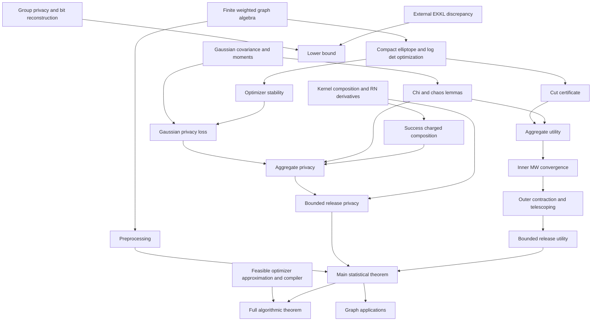

# Formalization plan for STOC2027

This project formalizes the current manuscript,
*Differentially Private Cut Release in Polynomial Time With Nearly-Linear Additive
Error*. Lemmas 10–23, Theorem 38, and Theorem 1's statistical conclusion are proved. At the
user's explicit choice, the current cost-accounting theorem is
`theorem1_of_lsw : MainTheoremStatement (realArithmeticLSWModel hLSW)`.
It takes the formal `LSWStatement` parameter. PSD separation and dense linear
algebra have proved scalar formulas, semantic refinement and compositional
cost bounds. The SDP reduction, public magnitude and precision bounds, timeout
laws, restarts, privacy, accuracy and polynomial bounds on assigned costs are
proved in Lean. Actual real-arithmetic running time is not certified:
`CostedLaw` and `Arithmetic` store costs, and `TimedAlgorithm` allows arbitrary
measurable functions with reported completion time zero. The formal LSW
parameter does not enforce execution of the cited algorithm or operation counts.
The earlier approximate/exact-SDP contract theorems are retained. The release
includes the paper's public noisy-mass cap. The separately proved deterministic
ellipsoid feasibility algorithm remains available; completing an arithmetic-only
optimizer and connecting costs to execution steps remain separate obligations.

The original specification was based on `STOC2027.tex`, SHA-256
`2ef841b6fabb55ceb08c4f5b9d6a8548959dc79132cb686c468744d0be2dd592`.
Theorem 1 and Lemmas 12, 15, 14, 16, 17, 18, 19, 20, 21, 22, and 23 were checked against manuscript revision
SHA-256 `98ed3a3dc40c86e474223f1da7ddf286e3d43b5190633d797a4699588850763b`.
Theorem 38 was checked against manuscript revision SHA-256
`15bf836dc23bfab2436fd80d915bfaf7cf2b17e484894664f36b888c34257011`,
where it is the active `thm:lower_bound` at lines 4336–4356. Its existing Lean
target is unchanged; the γ = 0 infinity convention remains explicit in `lowerScale`.
The initial Appendix C review used manuscript
SHA-256 `86cc5dde2485592bc2985e6ed59e60760d71fb5ed323711afb707550ef91d5a9`.
These hashes identify historical review snapshots. `source_inventory.json`,
`SourceStatements.tex`, and `LemmaComparison.tex` are regenerated from the current
manuscript and record its current hash. The source-to-Lean mapping below records
the reviewed associations; use the generated files for current line locations.
In particular, the Lemma 14 target now uses the current source's `δ₁ < 1/2`.
The existing manuscript edits and `section5.patch` were left untouched. The older
audit is useful context but is not the source of the theorem statements. Neither
`pureDP/` nor `codex6/` is part of this formalization.

## Approximate release and LSW-style cost accounting

The proposition `LSWStatement` in `LSWStatement.lean` is intended to encode a
polynomial consequence of Lee–Sidford–Wong (arXiv:1508.04874v2), Theorem 42,
Section 10.1, using the current abstract cost interface.
It concerns full-dimensional compact convex bodies and concave objectives with
exact separation/supergradient oracles. Uniform constants are quantified before
all problem data. Its scale includes dimension, the proved bound on the counted oracle's cost,
log outer/inner radius, and log objective range/accuracy. Completion-time labels
and timeout laws are explicit, but the interface does not derive these labels
from execution steps. Its zero-time loophole remains even with the counted
oracle connected. Passing this proposition as a hypothesis does not isolate an
operational LSW runtime theorem. No new axiom is introduced.

| Module | Verified responsibility |
| --- | --- |
| `TimedAlgorithm` | Timeout law for reported times, Markov bound, independent restarts and assigned costs |
| `SDPLinearOracle`, `SDPObjectiveBounds` | Log-det supergradient, concavity, eigenvalue/log-det and objective range bounds; semantic interface instantiated by verified linear algebra |
| `SDPCoordinates` | Full-dimensional bounded redundant `n²` coordinates; radius `1/4` inner ball, radius `2n` outer ball; every feasible matrix represented |
| `SDPSeparation`, `SDPLSWProblem` | Correct measurable ball/PSD separation and first-order oracle for the actual objective |
| `SDPLSWAlgorithm` | LSW specialization and feasible approximate output after bounded restarts |
| `SDPRuntimeData`, `LSWPolynomialRuntime` | Public magnitude, gap, logarithmic precision, timeout and restart polynomial bounds |
| `LSWSolverFamily` | Construction of the solver family from LSW; no additional approximate-SDP assumption |
| `BoundedObjectiveRelease` | Objective guard inactive on every reached history under public mass clipping |
| `RandomizedOracleTV`, `LSWWitness` | Covariance error plus solver-failure TV bound for actual witness draws |
| `LSWRelease`, `Theorem1LSW` | Actual release kernel, privacy/accuracy transfer and uniform bounds on assigned costs |

The public objective bound is
`massCap + (1+gamma)*card(Edge n)*U`, with the parameters of the bounded release.
`boundedObjective` replaces an invalid objective by zero. The guard allows the
existing worst-case cost semantics to continue taking a supremum over **all**
intermediate values; the reference-law equality proves it never changes actual
calls. The reduction does not assume a bound on the original graph's weights.
Coarse bounds `lam <= 10^40 R^7` and `publicObjectiveBound <= 10^10 R^5` are proved
for `R = runtimeScale n p`, before the constant-factor privacy/failure split.

With `r = approximationRadius n p`, the requested objective gap is `r²/(8*n⁴)`,
which is strong enough for covariance radius `r/2` since calibrated `lam >= 8`.
The timeout is `ceil(2*C*solverScale^degree)+1`; the number of independent attempts
is `ceil(2*log(2/r))+1`. Their total failure probability is at most `r/2`.
Every output is feasible, including the identity fallback. This gives the same
witness TV budget as the earlier deterministic approximation proof. The actual
full output is within `implementationTV p` of the ideal mechanism with internal
beta and delta halved. The final theorem keeps exponent 7, coefficient `2^178`,
nonnegative outputs, `(epsilon,delta)` edge-DP, and success probability `1-beta`.

The PSD budget `100*(n+1)^3` and conservative
`1000*(n+1)^6 + 2*100*(n+1)^3` first-order-oracle budget are now justified by
scalar implementations. The complete implementation is a constructed
`LinearAlgebraImplementation`, not an external theorem argument. The model
retains its outer vector/arithmetic macro semantics and exact scalar operations,
elementary functions and sampling conventions. This is not a bit-operation
result, and it does not establish operational real-arithmetic runtime either.
Appendix C uses the same cost-accounting interface and limitation.
`AuditLSW.lean` and `AuditLinearAlgebra.lean` check the new chain; the global audit
rejects `sorryAx` and all nonstandard axioms. These audits do not establish that
the computational model captures execution time.

## Verified linear-algebra implementation

| Modules | Proved implementation and refinement |
| --- | --- |
| `MatrixElimination`, `MatrixPSDAlgorithm` | Scalar Schur identities; PSD decision with a negative quadratic-form witness; singular/zero-pivot cases; measurability; totalization by symmetrization |
| `MatrixSPDAlgorithm`, `MatrixFactorAlgorithm` | Positive-definite solves, inverse, determinant and Cholesky factor, with exact matrix identities |
| `ScalarArithmetic`, `FiniteArithmetic` | Counted scalar operations, comparisons, finite sums and materialized vectors |
| `Arithmetic`, `CostedArithmetic` | Shared counted-result type and composition of random programs with counted deterministic computations |
| `MatrixArithmetic`, `MatrixSPDArithmetic` | Semantic refinement and uniform polynomial counter bounds for every elimination algorithm |
| `SDPArithmeticCoordinates`, `SDPArithmeticData` | Explicit adjoint formula, coordinate lift, objective matrix, norm, objective guard, gradient and separation normal |
| `SDPArithmeticOracle`, `SDPArithmeticFallback` | Exact agreement with the LSW oracle and feasible fallback, within the existing public charges |
| `SDPDecode` | Semantic feasible-output/fallback specification, independent of its implementation |
| `MatrixGaussianAlgorithm`, `ScalarGaussianSampling`, `VerifiedGaussianSampling` | Equality of covariance laws, sequential scalar draws, and a factor-based Gaussian batch within the existing charge |
| `VerifiedLinearAlgebra`, `Theorem1LSW` | Constructed implementation certificate connected to the release's law and assigned-cost proofs |

PSD testing uses a negative diagonal directly; a zero pivot with a nonzero
off-diagonal row entry yields an explicit two-coordinate negative witness;
a zero row is removed; positive pivots recurse on the scalar Schur complement.
The returned negative witness is lifted back to the original coordinates.
Symmetrization makes every returned witness valid even for nonsymmetric inputs.

For positive-definite matrices every pivot is positive. The inverse implementation
solves one system per column, so the deliberately simple bound is quartic:
`21*(n+1)^4`. Determinant and covariance-factor counts are respectively bounded
by `10*(n+1)^3` and `20*(n+1)^3`. A general faster inverse is unnecessary for
the polynomial-time target. The full oracle still fits its former public charge.
The sampler uses a finite sequence of scalar normal draws, followed by the
factor transform; its exact law equality allows the existing privacy and utility
proofs to be reused. No exact matrix-square-root or spectral algorithm is assumed.

The LSW oracle interface now requires a counted answer program and its cost
bound. `VerifiedLinearAlgebra` supplies that program, semantic refinement and
cost proof to the oracle. `LSWSolverFamily` preserves the entire implementation
when choosing the external algorithm family; `SDPLSWAlgorithm.solve` runs its
counted decoder through `mapArithmetic`. `ApproxSDPCosted.trials` uses the
constructed Gaussian sampler directly, and its distribution/cost proofs consume
the sampler's verified bounds. Both Theorem 1 and the application runtimes follow
these paths. `AuditImplementation` checks these dependencies without treating
proofs merely stored in the implementation record as evidence of use.
The `Arithmetic` type itself remains a value/count pair. These connections
verify the use of the concrete formulas and counters; they do not restrict all
programs to permitted scalar instructions. That restriction and its execution
semantics are still required for an operational runtime theorem.

## What compiles and what it means

`DPCut.lean` imports the six specification modules and the proof modules below:

| Module | Content |
| --- | --- |
| `Definitions` | Weighted graph coordinates, cuts, probability/DP predicates, SDP geometry, Gaussian and Laplace laws, clipping, witnesses, KL, parameters and lower-bound scale |
| `Algorithms` | Ideal probability-measure semantics of FindWitness, AggregateWitnesses, CutRelease and the complete release; explicit public parameter formulas |
| `MassClipping` | Public noisy-mass cap, inactivity on the utility good event, initial/MW mass bounds, and bounded discrepancy objectives |
| `EllipsoidGeometry`, `EllipsoidDeterminant`, `EllipsoidVolume` | Explicit central cuts, containment, determinant contraction, and volume certificates |
| `EllipsoidAlgorithm`, `EllipsoidFeasibility` | Recursive feasibility algorithm, ordinary separation interface, termination, and dimension/radius iteration bound |
| `Privacy` | Laplace mechanism, randomized postprocessing, basic/advanced adaptive composition, success-charged composition and TV transfer targets |
| `Statements` | SDP and Gaussian lemmas; preprocessing, oracle and bounded-release claims; upper and lower main theorem targets |
| `Utility` | Inner/outer termination, MW progress, mass contraction, retirement, optimization precision and coherent parameter-choice obligations |
| `Applications` | Capped release, KL projection, partitions, constrained cuts, correlation clustering, Max-k-Cut and hierarchical clustering targets |
| `ChiSquare` | Proved squared-Gaussian exponential moments and chi-square tail bound with `c = 1/32` |
| `GaussianWitness` | Proved feasibility bounds, normalization of the covariance law, and standard-normal batch projection needed by Lemma 10 |
| `Lemma10` | Proved `lemma10 : ChiStatement`, including measurability, union bound, and clipping, with `C = 96` |
| `GaussianMoments` | Finite-Lp closure, Gaussian moments through order eight, and independent-sum moment expansion for Lemma 11 |
| `QuadraticMoments` | Centered diagonal Gaussian quadratic fourth moment bounded by 15 times variance squared |
| `GaussianQuadratic` | Orthogonal invariance, spectral diagonalization, and the general symmetric quadratic moment bound |
| `OneSidedMoment` | Proved probability at least `1/1024` of exceeding the quadratic form's mean, including zero variance |
| `WitnessQuadratic` | Exact batch-law representation as a quadratic form and computation of its mean |
| `Lemma11` | Proved `lemma11 : ChaosStatement` with `C = 512`, `c₀ = 1/2048`, signed weights and the original conditioning event |
| `CutBasics`, `EdgeCard` | Shared measurable cut algebra and the finite edge-count bound; extracted from existing utility helpers |
| `PreprocessAlgebra` | Exact clipped/excess decomposition, boundedness, sensitivity contraction, positive thresholds, and coordinate-to-cut error bounds |
| `LaplaceVector`, `LaplaceVectorTail` | Joint shifted product density, pure privacy for unit ℓ₁ sensitivity, and simultaneous finite-vector noise-tail bound |
| `PreprocessPrivacy`, `PreprocessUtility` | Normalization and privacy of the original release law, exact tail calibration, and simultaneous relative cut accuracy |
| `Lemma12` | Proved `lemma12 : PreprocessStatement`, with the unchanged thresholds, hypotheses, and conclusion |
| `LogDet` | Proved directional determinant and log-determinant derivatives from mathlib's continuous multilinear determinant |
| `SDPGeometry` | Proved compact/convex feasibility, the quadratic query formula, matrix/edge objective identity, and optimizer existence |
| `RelativeMatrix` | Proved inverse/square-root and Frobenius identities, zero-distance characterization, and the endpoint query estimate |
| `Optimizer` | Proved first-order optimality, uniqueness, attainment of `F(D)`, and `optimizer_foundations : OptimizerStatement` |
| `Lemma13` | Proved `lemma13 : OptimizerStabilityStatement` and its specialization to `X_D` and `X_(D+ξ)` |
| `WeightedChiSquare` | Proved centered Gaussian-square MGF, sharp logarithmic MGF bound, optimized Chernoff bound, and signed two-sided tail |
| `Lemma15` | Proved `lemma15 : WeightedChiSquareStatement`, with exact constant 2; also arbitrary independent standard normals |
| `GaussianComparisonMatrix` | Proved relative precision, determinant and trace identities; eigenvalue bounds for drift and variance |
| `GaussianLikelihood` | Proved batch distribution after orthogonal coordinates, exact likelihood decomposition, and density-form equivalence |
| `Lemma14` | Proved `lemma14 : GaussianPrivacyStatement` and `lemma14_density`, with explicit universal constant 4 |
| `Sequential` | Measurable finite transcripts, Markov recording kernel, probability laws, fixed lengths, absolute continuity and accumulated charges |
| `SuccessChargedMoment` | Exact one-step exponential-moment estimate, including zero mass at the failure symbol |
| `KernelLikelihood` | Jointly measurable kernel log densities, pure-privacy loss bounds and inverse-density normalization |
| `SequentialLikelihood` | Density chain rule and exponential-moment induction for finite adaptive processes |
| `MomentPrivacy` | Eventwise privacy from the exponential moment and an almost-sure charge budget |
| `TotalVariation` | Hahn-decomposition residual measure, bounded-test transfer, adaptive TV accumulation and symmetric privacy transfer |
| `SuccessChargedComposition` | Auxiliary support on common histories, zero-loss equality and auxiliary privacy bound |
| `Lemma16` | Proved `lemma16 : SuccessChargedStatement`, with the exact constants and unchanged hypotheses |
| `OptimizerMeasurable`, `DensityTools`, `GaussianDensity`, `LaplaceDensity` | Continuous optimizer selection, change of variables, actual Gaussian batch densities and normalized Laplace law |
| `WitnessNormalization`, `OracleSensitivity`, `OracleGoodEvent` | Measurable normalization, signed objective sensitivity and common high-probability conditioning event |
| `ConditioningPrivacy`, `OracleTrial`, `OracleCalibration` | Conditioning normalization/TV estimates, joint noisy-score density and calibrated one-trial auxiliary privacy |
| `ProbabilityProgramming`, `RepeatUntil`, `OptionStandardBorel` | Measurable finite sampling, first-accepted output, privacy/TV/absolute continuity through repetition, and standard Borel option outputs |
| `FindWitnessPrivacy`, `FindWitnessSupport`, `OracleMeasurable` | Concrete K-trial oracle, measurable auxiliary kernels, accepted-witness bounds and success charges |
| `WitnessTranscript`, `AdaptiveWitnessPrivacy` | Residual potential, auxiliary almost-sure budget and Lemma 16 applied to concrete adaptive oracle kernels |
| `SequentialContinuation`, `AggregateTranscript`, `AggregateContinuation` | Two-call schedule, padding, exact equality with `aggregateLaw` and normalization of that law |
| `PublicOracleCalibration`, `Lemma17` | Explicit positive privacy constants, all numerical inequalities and `lemma17 : AggregatePrivacyStatement privacyConstants` |
| `PurePrivacyMoment`, `PureAdaptiveComposition` | Hoeffding bounds for bounded privacy loss and adaptive pure-private likelihood moments |
| `PrivacyTrimming`, `BalancedPrivacy`, `PurePartKernel` | Jointly measurable clipped laws, equal-mass balancing, and pure-private probability kernels dominated by the actual laws |
| `SubpartComposition`, `AdaptiveComposition`, `BasicPrivacyComposition` | Adaptive domination of subparts, exact additive failure accounting, and proved basic/advanced composition for symmetric neighboring pairs |
| `AggregateMeasurable`, `NoisyMassPrivacy` | Standard Borel aggregate outputs, joint aggregate measurability, residual support, mask contraction and translated Laplace privacy |
| `AdaptiveLoop`, `InnerLoopMeasurable`, `InnerLoopPrivacy` | Measurable finite state programs, exact early-stopping transcript interpretation, inner-loop probability laws, support and privacy |
| `OuterLoopMeasurable`, `OuterLoopPrivacy` | Probability-valued outer continuation, support-aware basic composition and mask preservation |
| `MainPrivacyCalibration`, `Lemma18` | Exact public privacy ledger and `lemma18 : MainPrivacyStatement privacyConstants` for the original CutRelease law |
| `ShrunkenCut` | Proved shrunken-cut feasibility, query formula, exact determinant, logarithmic penalty bounds and objective pairing |
| `Lemma19` | Proved `lemma19 : SDPCertificateStatement` with `C = 2`, the exact shrunken-cut certificate and the total-mass inequality |
| `UtilityCertificate` | Feasible log determinant is nonpositive; optimizer score dominates F; both failed SDP bounds give all-cut error with constant 16 |
| `LaplaceTail`, `FailureProbability` | Exact one-sided noise tails, geometric failure of repeated fresh trials, and measurable adaptive union bounds |
| `WitnessRetirement`, `OracleUtility` | Active maximum attainment, strict retirement, signed normalization and utility of the actual FindWitness law |
| `AggregateUtility` | Partition and sign invariants, active-cardinality fuel invariant, and finite adaptive aggregate utility |
| `UtilityCalibration`, `Lemma20` | Explicit error budget and `lemma20 : AggregateUtilityStatement utilityConstants`; joint aggregate privacy and utility with one choice of constants |
| `FiniteKL` | Finite probability measures, absolute continuity from support, finite mathlib KL, and the exact normalized weighted-log formula |
| `MultiplicativeWeights` | Positive normalizer, mass/support preservation, exact potential difference, and `mw_potential_progress : MWProgressStatement` |
| `InnerProgress` | Both normalized witness margins, initialization and potential bounds, and the strict ceiling/horizon inequality |
| `InnerLoopUtility`, `MassEstimateUtility` | Adaptive inner-loop exhaustion bound, two-sided Laplace event, and continuing-round mass comparisons |
| `OuterProgress`, `InnerContraction` | Finite cut averaging, exact mass transfer and 19/20 contraction, with inner success and contraction on one good event |
| `OuterStopsMeasurable`, `OuterLoopUtility` | Measurable probability-valued stopping flag and adaptive failure bound including the stopping round |
| `OuterUtilityCalibration`, `OuterLogBounds`, `OuterBudgetBounds`, `StoppingCalibration` | Positive explicit outer constants, logarithmic budget bounds, and the global stopping-threshold inequality |
| `OuterHorizon`, `Lemma22` | Logarithmic horizon reserving a final stopping test, and `lemma22 : OuterRoundStatement outerUtilityConstants` |
| `InnerUtilityCalibration`, `Lemma21` | Public parameter and certificate bounds, measurable joint round law, and `lemma21 : InnerRoundStatement utilityConstants` |
| `CutReleaseInvariant` | The retired-weight identity and accumulated-error invariant, using the shared `CutBasics` module |
| `InnerReleaseUtility`, `ReleaseUtility` | Joint inner success/contraction/cut accuracy and the actual output law's error `T₁B + stop` with one adaptive failure budget |
| `ReleaseCalibration` | Uniform error coefficient `2^121`, logarithmic exponent 7, and exact failure budget β |
| `ReleaseNonnegative`, `Lemma23` | Nonnegative output almost surely including fallbacks, and `lemma23 : BoundedUtilityStatement outerUtilityConstants` |
| `SharedPrivacy` | Privacy with outer coefficient 80 and stopping coefficient 2^120; one shared `ParameterChoiceStatement` witness |
| `MainParameters`, `MainCalibration` | Exact half-budgets, clipping adjacency, positive U, logarithmic absorption, and uniform final coefficient 2^166 |
| `FullReleaseLaw`, `FullReleasePrivacy`, `FullReleaseUtility` | Measurable full Markov kernel, normalization/nonnegativity, composed privacy, and joint all-cut accuracy |
| `Theorem1` | Unconditional `theorem1_statistical` explicitly names `fullReleaseLaw`; `theorem1_statistical_exists` proves `MainStatisticalStatement` as a corollary |
| `CostedProgram`, `CostedProgramLaw`, `CostedProgramBounds` | Explicit primitive-cost semantics, exact law equality, and worst-case bounds for every finite loop and fallback |
| `RuntimeParameters`, `PolynomialRuntime` | Public horizons/sample sizes bounded polynomially in `runtimeScale`; uniform polynomial cost closure |
| `OracleReplacement`, `OracleReplacementMeasurable`, `OracleReplacementLaw` | Release loops parameterized by a Markov witness kernel; measurability, probability, and exact identification with the original mechanism |
| `OracleReplacementTV`, `OracleReplacementCost` | Adaptive TV accumulation and the original assigned block-cost semantics with a replaceable witness implementation |
| `ApproxSDPOracle`, `ApproxSDPCosted` | Explicit feasible approximate optimizer contract; actual costed Gaussian/Laplace witness trials |
| `ApproximationTransfer` | Half-budget calibration, error-constant absorption and high-probability TV transfer, independent of rational rounding |
| `ApproxSDPPrecision`, `ApproxSDPRelease`, `ApproxSDPRuntime` | Public accuracy request, full-law TV bound, unchanged final privacy/failure budgets, and polynomial assigned-cost bounds including precision |
| `Theorem1LSW` | `theorem1_of_lsw` proves `MainTheoremStatement (realArithmeticLSWModel hLSW)` from the explicit LSW hypothesis and verified linear algebra |
| `Theorem1Oracle` | `theorem1 : MainTheoremStatement (realArithmeticOracleModel sdp)` under `ApproxSDPOracle`; previous theorem retained as `theorem1_exact_oracle` |
| `CubeMoments`, `BipartiteDiscrepancy` | Finite Rademacher second/fourth moments, absolute-moment lower bound, and rectangular discrepancy |
| `LowerGroupPrivacy` | Nonnegative interpolation paths, approximate group privacy, and floor-based ε/δ calibration |
| `FiniteReconstruction`, `CutReconstruction` | Measurable finite selector with fallback, finite-cube reconstruction, and common compatible output for Hamming-separated inputs |
| `EmbeddedGraphs`, `CutDiscrepancy`, `BipartiteGraphs` | Concrete graph embeddings, nonnegativity/mass/sensitivity, boundary-cut to rectangle identity, and bipartite compatibility bound |
| `BipartiteLowerBound`, `StarLowerBound` | The small-γ bipartite and near-one-γ star lower bounds, with explicit constants |
| `LowerCalibration`, `Theorem38` | Integer square-degree choice and `theorem38 : LowerBoundStatement` with c = 2⁻³⁰ |

Every specification target is a `def ...Statement : Prop`. This checks its type without asserting
its truth. There are no `sorry` proofs, custom axioms, or opaque placeholder
algorithms. The ideal algorithms are defined by finite recursion and integration
of concrete laws. FindWitness, AggregateWitnesses, and both CutRelease loops now
have proved measurability and probability normalization under the calibrated
privacy parameters. The residual masks remain in `[0,1]` almost surely.
The selected optimizer uses classical choice with identity as a total fallback;
`optimizer_foundations` proves that it is the unique optimizer, so the fallback
is unreachable for `n ≥ 2` and `λ > 0`. `F(D)` is its attained objective value.
The separate theorem `lemma10` now proves `ChiStatement`; its entire prerequisite
chain is checked, without assuming any of the other specification targets.
Likewise, `lemma11` proves `ChaosStatement`. Its moment proof uses the spectral
theorem instead of the general `HypercontractivityStatement`, which remains an
unproved specification target. The constants in Lemma 11's existential statement
are instantiated explicitly, without changing its hypotheses or conclusion.
`lemma12` proves the unchanged `PreprocessStatement` from the current
`STOC2027.tex:2156` (`lem:preprocess`). The algorithm releases only
`Y = max(0, excess U w + L − V)`; the clipped vector stays private. The coordinatewise
excess map preserves ℓ₁ adjacency. The joint Laplace law
is normalized, its shifted product density is derived from mathlib's `Measure.pi`,
and the likelihood ratio is bounded by `exp ε₀` before measurable postprocessing.
This directly proves the finite-vector mechanism needed here, without assuming
the separate general `LaplaceMechanismStatement`.

The good event is `∀ e, |L e| ≤ V`. The tail calibration gives
`exp(-V/(1/ε₀)) = (β₀/n)^2`; a finite union bound and `card(Edge n) ≤ n²`
give failure probability at most `β₀² ≤ β₀`. On that event, zero excess stays zero;
positive excess implies `w e > U = 4V/γ`, so the edge error is at most
`2V ≤ (γ/2) w e`. Summing proves the single event of accuracy for every cut.
The proof uses nonnegative weights and `n ≥ 2`; the stated upper bounds on ε₀
and γ are retained but not needed by the stronger helper theorems.
`AuditLemma12.lean` checks the theorem and immediate prerequisites transitively.
Only `propext`, `Classical.choice`, and `Quot.sound` occur. Common cut and edge-count
helpers were moved into small shared modules with their existing names preserved.

`lemma13` now proves both conclusions of `OptimizerStabilityStatement`, with
arbitrary signed perturbations. The pairing identity is proved for feasible
matrices; its quadratic query form uses their symmetry and unit diagonal.
Existence uses compactness and continuity. Uniqueness uses the first-order
inequalities and the positive relative Frobenius energy, avoiding a separate
strict-concavity development.
`AuditLemma13.lean` prints the transitive axiom dependencies of the new results:
only the standard `propext`, `Classical.choice`, and `Quot.sound`, with no admissions.

`lemma15` proves the signed Laurent–Massart tail bound, including zero weights
and empty finite index types. `lemma15_independent` transfers the product-law
result to any probability space carrying independent standard normals.
After that proof compiled, `lemma14` was proved with `C = 4`, and
`lemma14_density` supplies the manuscript's two product inequalities.
The density expression is explicitly identified with
`exp(-zᵀX⁻¹z/2) / sqrt((2π)^n det X)` by `gaussianDensity_eq`.
The proof uses `B = sqrt(X₀) X₁⁻¹ sqrt(X₀)` and its positive eigenvalues `rᵢ`:
`d² = Σ (rᵢ−1)²/rᵢ`, the drift `Σ(rᵢ−1−log rᵢ) ≤ d²`,
`Σ(rᵢ−1)² ≤ 2d²`, and `|rᵢ−1| ≤ 2d` for `d < 1/2`.
The exact law after the change of coordinates is proved, not assumed.
`AuditLemmas14_15.lean` checks these results' transitive axiom dependencies.

`lemma16` now proves the success-charged composition target, as stated in
`STOC2027.tex:2358–2390`, with its proof at lines 3132–3325.
The measurable auxiliary kernels are assumptions of the statement; their existence
from a particular mechanism is not assumed to follow from pointwise existence.
The proof uses mathlib's jointly measurable `Kernel.rnDeriv` and the project's
existing disjoint-union product sigma algebra on `List Y`.
It proves that both auxiliary prefix laws are absolutely continuous with respect
to both actual prefix laws. Thus the auxiliary process stays on common histories
almost surely, even though conditional guarantees are required only there.

For `a = 1/(4ℓ*)`, the scalar estimate bounds
`E[exp(a(z − 4ℓ·1[success]))]` by one. An affine bound in `exp(-z)` avoids
division by the failure-atom probability. The measurable density chain rule and
finite induction give the full-transcript moment. An eventwise integral bound
then gives `(4L + 4ℓ* log(1/δ''), δ'')` privacy of the auxiliary laws.
When `ℓ* = 0`, the auxiliary transcript laws are equal.
The conditional TV errors telescope to `kδ'`; symmetric TV transfer adds
`(1 + exp ε)kδ'`. This integrates conditional errors under auxiliary histories,
so the paper's piecewise extension to kernels `Q` is unnecessary.
Both auxiliary almost-sure budget assumptions are retained, one for each direction.
`AuditLemma16.lean` reports only `propext`, `Classical.choice`, and `Quot.sound`
for the result and its immediate prerequisites.

`lemma17` proves the unchanged `AggregatePrivacyStatement privacyConstants` from
`STOC2027.tex:2393`, for all `n ≥ 2`, `ε,δ,β,γ ∈ (0,1)`, and the fixed candidate
`h` in that statement. Its proof in fact does not need nonnegativity of `h`, `w`,
or `w'`; signed objectives and the L1 adjacency bound suffice.
The public constants are `trials = 8192`, `batch = 512`, and
`regularization = 1073741824`; the other three constants are 1 and do not enter
this privacy lemma. `privacyConstants_positive` and
`public_oracle_privacy_bounds` certify positivity and every numerical condition,
including ceilings, `δ₁ < 1/2`, `λ ≥ 8`, and the batch likelihood calibration.
These are privacy constants, not a proof of the later combined utility ledger.

The common trial event has probability at least `1 − 2δ₁` under either actual
law. The joint batch/noisy-score density ratio costs `5ε₁W`; conditioning costs
`10ε₁W`. Repeating the conditioned trial independently and returning the first
accepted witness yields pure charge `10Kε₁W`, TV error at most `2Kδ₁`, and
absolute continuity with respect to the actual `findWitness` law. These are
jointly measurable kernels, proved from optimizer continuity and density formulas.
On accepted auxiliary outputs, `0 ≤ g ≤ r` and `r_e q_e^max ≤ 8g_e`.
The residual potential telescopes under both auxiliary processes, giving
successful charge at most `80Kε₁‖w−w'‖₁ ≤ 80Kε₁`.

The two-call schedule pads a skipped minus call and all calls after termination
with `none`. `aggregateLaw_eq_transcript` proves exact equality with the existing
finite recursive algorithm, including zero-residual and double-failure branches.
Its horizon is `2 card(Edge n) ≤ n²`; the bound uses the existing aggregate fuel,
without presupposing the later utility or outer-retirement targets.
Lemma 16 with `δ'' = δ/2` then gives the required `(ε,δ)` bound.
`AuditLemma17.lean` checks the transitive dependencies: only `propext`,
`Classical.choice`, and `Quot.sound`; there are no custom axioms or admissions.

`lemma18` proves the unchanged `MainPrivacyStatement privacyConstants` from
`STOC2027.tex:2622–2663`. Its assumptions are exactly `n ≥ 2`, `U ≥ 1`, and
`Parameters.PrivacyValid`; the actual `cutReleaseLaw` and its public configuration
are unchanged. The stronger pairwise helper `cutRelease_private` also works for
signed input vectors with L1 distance at most one.

The immediate composition prerequisites are proved, not taken from the inventory
as assumptions. For pure privacy loss `z ∈ [−ε₀,ε₀]`, inverse-density normalization
and Hoeffding's lemma give `E[z] ≤ ε₀²/2` and the required exponential moments.
For approximate privacy, clip both jointly measurable kernel densities, balance
their masses while retaining the same pure-privacy parameter, and normalize.
Each actual conditional law dominates `(1−δ₀)` times its pure part. Sequential
domination gives a common weight `(1−δ₀)^k`, so discarded mass costs at most
`kδ₀`, with no exponential multiplier. This proves the usual advanced bound
`ε₀√(2k log(1/δ′)) + kε₀(exp ε₀−1)` and failure `kδ₀+δ′`.

**Composition assumption made explicit:** `advanced_composition` is stated using
`Indistinguishable` for each fixed pair, so it requires both privacy directions.
`AdvancedCompositionStatement` explicitly requires `Symmetric adj`, so its
per-step DP hypotheses supply both directions. `advanced_composition_statement`
proves this full generic target, including `k = 0` and `δ₀ ≥ 1`, without adding
hypotheses. Lemma 18 continues to use the pairwise theorem, with both directions
supplied by undirected edge adjacency. The standard Borel output requirement and all joint measurability
and Markov-kernel obligations are proved for the concrete programs.

The inner-loop state records whether a candidate has already been accepted;
`innerLoop_eq_stateLoop` verifies the stopped branches exactly. Accepted residuals
are masks almost surely, and `residualUpdate_isMask` preserves the outer mask.
The Laplace mass release uses sensitivity at most one after masking.
The public horizons are positive, `ε_GE,δ_GE,β_GE ∈ (0,1)`, and the inner
composition has budget at most `(ε/(2T₁),δ/T₁)`. Adding the mass release and
composing `T₁` rounds gives `(ε,δ)` exactly. No utility, termination-success,
runtime, or later-lemma claim is used. `AuditLemma18.lean` checks the entire chain
and reports only `propext`, `Classical.choice`, and `Quot.sound`.

`lemma19` now proves the SDP certificate from `STOC2027.tex:2666–2685`, with
the universal constant `C = 2` and the exact conclusion `mass D ≤ 2F(D)`.
Both existing certificate targets are unchanged. The hypotheses make explicit
the paper's implicit `n ≥ 2` and positive regularization parameter; edge weights
remain arbitrary signed reals. The helper `sdp_cut_bound` proves the sharper
error `2λn log n + ‖D‖₁/n` for every `λ ≥ 0`.
The immediate prerequisites prove feasibility and the exact query formula for
`X_S = (1 − 1/n)ssᵀ + I/n`. Mathlib's matrix determinant lemma gives
`det X_S = (n − 1 + 1/n)(1/n)^(n−1)`; its logarithm satisfies
`0 ≤ −log(det X_S) ≤ n log n`. Testing the objective at `X_S` gives
`lemma19_shrunken : ShrunkenCutCertificateStatement`, and testing at the identity
matrix proves the total-mass inequality. `AuditLemma19.lean` reports only
`propext`, `Classical.choice`, and `Quot.sound`, with no admissions or custom
axioms.

`lemma20` now proves the existing aggregate utility target from
`STOC2027.tex:2689–2771`, for the unchanged `aggregateLaw`. The hypotheses are
`n ≥ 2`, `U ≥ 0`, `ε,δ,β,γ ∈ (0,1)`, `0 ≤ w_e ≤ U`, and `h_e ≥ 0`.
`utilityConstants` changes only `certificate` from 1 to 16; `oracleConfig` is
definitionally the same as in Lemma 17. Thus `K = ⌈8192 log(n/β)⌉`, the batch
coefficient 512, and the regularization coefficient 2³⁰ are unchanged.
`aggregate_privacy_and_utility` proves both aggregate statements with these
constants. The separate Lemma 18 theorem retains its original constants;
the complete common-constant ledger is not claimed here.

The immediate prerequisite chain is:

1. `feasible_logdet_nonpos` applies `log x ≤ x−1` to the positive eigenvalues,
   whose sum is n. Consequently the optimizer's linear score is at least F(D).
2. Exact Laplace tails give probability β₁/2 of a noise value above τ₁ and
   probability at least 1−β₁/2 ≥ 3/4 of noise at least −τ₁. A wrong-sign
   accepted witness requires the first event; clipping need not be globally
   conditioned on for this part of the proof.
3. Lemma 11's proved joint success bound 1/2048, independence of the validation
   noise, and `F(D) ≥ 4τ₁` give one-trial success probability at least 3/8192.
   Positive score implies a positive active maximum because `D = r ⊙ v`.
   The exact first-accepted distribution has failure probability at most
   `(1−3/8192)^K`; the accepted-sign failure is at most `Kβ₁/2`.
4. A normalized accepted witness equals r on some positive coordinate, and is
   between 0 and r everywhere. Hence the active-edge cardinality decreases
   strictly. Induction tracks this cardinality against the remaining fuel,
   the partition of one, and both accumulated sign inequalities. Two failed
   calls at a nonzero residual imply both SDP bounds. Lemma 19 then gives
   `B = 16(τ₁ + λn log n + nU)` simultaneously for every cut.
5. The adaptive failure accounting uses bounds valid for each fixed pre-call
   history; it never assumes independence after conditioning on a global event.
   Since `2 card(Edge n) ≤ n²`, the total failure is at most
   `n²[Kβ₁/2 + (1−3/8192)^K] ≤ β/8 + β/2 ≤ β`.

`AuditLemma20.lean` checks all these results and reports only `propext`,
`Classical.choice`, and `Quot.sound`.

`lemma21` proves `InnerRoundStatement utilityConstants` for the original
paper statement `lem:inner_round` (the subsequent `\iffalse` proof is excluded).
The conclusion is the joint assertion
`Pr[stop < Mtilde → inner result isSome] ≥ 1−T₂β_GE−β₂`.
The paper statement and algorithm are unchanged, including
`T₂ = 1 + ⌈64(1+γ)² log n / γ²⌉` and `η = γ/[8(1+γ)]`.
Its hypotheses are `n ≥ 2`, `U ≥ 1`, `p.IterationValid`, bounded nonnegative w, a mask a,
and the existing explicit assumption `stop ≥ 10(B + τ₂/γ)`. Lemma 22 now supplies
a global choice satisfying this inequality, with a larger outer coefficient;
`outerConfig_inner_utility_bounds_general` verifies its per-call prerequisites directly
from Lemma 20 and the public budget formulas.
The iteration parameter range permits `0 < delta, beta < 1`; the main theorem's
additional caps at `1/10` are unnecessary. A zero mask needs no separate
exception, since continuing on the good mass-estimation event implies positive
true mass. The generic `innerRound_utility` and `outerRound_utility` proofs also
apply to arbitrary run configurations satisfying the explicit local noise,
aggregate-utility, certificate, and horizon conditions, independently of the
main theorem's calibration.

The immediate prerequisites now establish the complete potential argument:

1. `finite_kl_formula` proves absolute continuity from support, integrability,
   finiteness, and the finite-sum formula for mathlib's `InformationTheory.klDiv`.
   `normalizedKL_finite_formula` identifies the existing potential with
   `Σ w_e log((w_e/M)/(h_e/Mtilde))`. Zero true weights are handled separately;
   no step treats an infinite KL converted to a real as a finite divergence.
2. The mass-release good event has probability at least `1−β₂`. On it, a
   continuing round has positive true and noisy masses,
   `M ≤ Mtilde ≤ (1+γ/4)M`, and `nU ≤ M`. The initialization preserves support
   and total estimated mass, and has potential at most `M log n`.
3. The partition identity and actual selected sign give normalized discrepancy
   at least `γ/[4(1+γ)]` whenever the aggregate is accurate and rejected.
   Multiplicative weights preserves total mass and positive support. Its exact
   potential difference and the exponential/logarithmic estimates give the
   decrement `γ²M/[64(1+γ)²]`. This separately proves `MWProgressStatement`.
4. The extra one in the horizon gives `M log n < T₂ · decrement` strictly.
   Induction on the actual inner recursion proves exhaustion probability at
   most `T₂β_GE`. Each step applies Lemma 20 to its current valid estimate;
   the oracle guarantee is discharged by the already proved theorem.
5. The measurable joint mass/inner-result law is a probability measure. The
   final adaptive bound adds `β₂` for the mass release to `T₂β_GE` for inner
   calls, without conditioning on the decision to continue.

`AuditLemma21.lean` checks the entire chain and reports only `propext`,
`Classical.choice`, and `Quot.sound`.

`lemma22` proves `OuterRoundStatement outerUtilityConstants`
for the original paper statement `lem:outer_round`. It reaches the actual stopping test
(`a = 0` or `Mtilde ≤ stop`), with probability at least
`1 − T₁T₂β_GE − T₁β₂`; merely exhausting the public horizon does not count as
success. The hypotheses are `n ≥ 2`, `U ≥ 1`, `p.IterationValid`, and
`Bounded U w`. The generalized stopping calibration uses `gamma ≤ 1/4` to
bound the global logarithm below, so it does not need `delta < 1/10`.
Specializations for `p.Valid` remain available to the main theorem and its
applications. Its proof adds the following immediate prerequisites:

1. `sum_cutQuery` toggles one endpoint of an edge, giving the exact finite
   average `1/2` over cuts. `mass_from_cuts : MassFromCutsStatement` then gives
   additive mass error `2B` from the simultaneous cut guarantee, without an
   additional probability loss. `residual_contraction` proves the existing
   `ResidualContractionStatement`, with contraction factor `19/20`.
2. `innerLoop_contracts_of_potential` strengthens the same induction used for
   Lemma 21: an accepted accurate partition contracts mass; a rejected one
   decreases potential. Thus both inner success and contraction hold except
   with probability `T₂β_GE`, rather than paying this budget twice.
3. `outerStopsLaw_failure` integrates conditional estimates over each fixed
   pre-call history. The two-sided mass event includes the stopping round.
   Mask preservation and the geometric mass budget justify recursion on the
   concrete stopping-flag law, including its fallback branches.
4. `outer_horizon_mass_bound` proves that `T₁ = ceil(80 log(nU))` leaves room
   for the final stopping test: after at most `T₁−1` contractions, mass is at
   most `nU`. All natural-number ceilings and the smallest admissible n are
   included in this estimate.
5. `outerUtilityConstants` retains Lemma 20's oracle and certificate constants,
   changes the outer coefficient to `80`, and the stopping coefficient to
   `2^120`. `outer_stopping_threshold` proves `stop ≥ 10(B + τ₂/γ)` uniformly
   for all admissible inputs. The deliberately coarse, unoptimized estimates
   include `T₁ ≤ 81ℒ`, `T₂ ≤ 102ℒ/γ²`,
   `ε_GE⁻¹ ≤ 50000ℒ²/(γε)`, `τ₂ ≤ 14000ℒ²/ε`,
   `τ₁ ≤ 3·10^22ℒ⁵/(γε)`, and `λ ≤ 10^28ℒ⁵/(γε)`.
   The stopping threshold is proved, not an added assumption or a structure
   field left to be instantiated.

`AuditLemma22.lean` audits this chain and reports only `propext`,
`Classical.choice`, and `Quot.sound`.

`lemma23` proves the unchanged `BoundedUtilityStatement outerUtilityConstants`
from the current `STOC2027.tex:2934–3031`, with the single uniform error
coefficient `C = 2^121`. The assumptions remain `n ≥ 2`, `U ≥ 1`, `p.Valid`,
and `Bounded U w`. It uses exactly Lemma 22's constants and the existing
`cutReleaseLaw`, without an abstract replacement oracle or an extra stopping
assumption. The simultaneous cut error is
`γ cut(w,S) + 2^121 (nUℒ + nℒ^7/(γε))`, with probability at least `1−β`.

1. `ReleaseInvariant w a out γ A` states nonnegativity of the accumulator and
   all-cut accuracy for the retired weights `w − a ⊙ w`. The exact identity
   `w − (a ⊙ (1−r)) ⊙ w = (w − a ⊙ w) + (a ⊙ w) ⊙ r`, together with
   cut linearity, updates this invariant with additive error `A+B`.
   This proves telescoping along the concrete recursion; the separate generic
   `RetirementStatement` inventory target is not assumed.
2. `innerLoop_release_of_potential` proves inner success, residual contraction,
   nonnegative released estimates, and simultaneous residual cut accuracy on
   the same good event. It charges only `T₂β_GE`, without separate union bounds
   for termination and accuracy and without an extra union bound over cuts.
3. `outerLoop_release_failure` tracks this invariant through the actual
   adaptive recursion. A continuing round has enough remaining horizon by
   Lemma 22's geometric budget. At a stopping test, the residual mass is at
   most `stop`; discarding it adds at most `stop` to the error. This yields
   `cutRelease_utility_explicit` with error `T₁B + stop` and failure
   `T₁T₂β_GE + T₁β₂`, including the stopping mass release.
4. `outer_certificate_bound` proves `B ≤ 16nU + 10^30 nℒ^6/(γε)` from the
   already verified oracle bounds. `release_error_bound` combines this with
   `T₁ ≤ 81ℒ`, `ℒ ≥ 1`, and the stopping formula to get the stated exponent 7
   and coefficient `2^121`. `release_failure_budget` proves the exact equality
   `T₁T₂β_GE + T₁β₂ = β`, including positivity of both horizon denominators.
5. `cutRelease_nonnegative` separately establishes nonnegative output almost
   surely even outside the utility good event. Multiplicative updates preserve
   nonnegativity for nonnegative released mass, residual masks are supported
   in `[0,1]`, and all fallback branches preserve the accumulator.

`AuditLemma23.lean` audits this chain and reports only `propext`,
`Classical.choice`, and `Quot.sound`. Theorem 1 now combines these constants
with preprocessing and the shared privacy proof described below.

Compilation of a **statement definition** is not a proof of that proposition. In
particular, a false proposition can also compile. Do not convert the targets to
axioms, or infer the main theorem from an abstract oracle whose assumptions simply
restate the desired conclusion.

`theorem1_statistical` explicitly names `fullReleaseLaw` and fixes the uniform
error constant. Its corollary `theorem1_statistical_exists` proves the existential
target `MainStatisticalStatement`. `MainTheoremStatement model` adds a single uniform program and a
uniform polynomial bound on the supplied cost function. The current proof uses
`realArithmeticLSWModel`; the earlier `realArithmeticOracleModel` theorem remains
a separate solver-contract result.
Application statements similarly specify statistical content; their external
algorithms' efficiency is a separate obligation.

## Theorem 1: completed statistical proof and oracle cost model

`theorem1_statistical` bundles measurability, normalization, nonnegative output,
privacy, and simultaneous all-cut accuracy for the specified `fullReleaseLaw`,
with constant `2^166`. The existential `MainStatisticalStatement` follows as
`theorem1_statistical_exists`.
`SharedPrivacy` redoes the privacy ledger for `outerUtilityConstants`, so privacy
and utility use the same mechanism, horizons, and stopping threshold.
`parameter_choice : ParameterChoiceStatement` records this compatibility.
Clipping is proved to contract ℓ₁ adjacency. The full mechanism uses the exact
budget split from `fullReleaseLaw`: preprocessing `(ε/2, β/2, γ)` and bounded
release `(ε/2, δ, β/2, γ/2)`. The two failure probabilities sum to β; the two
relative errors sum to at most γ times the original cut, because clipped cuts
are no larger than input cuts. Nonnegative output holds almost surely on all
inputs, including failures. Measurability and normalization are proved before
constructing `fullReleaseKernel`.

For `L = log(n/(δβγε))`, the calibration proves `U ≤ 48L/(γε)` and the bounded
call's logarithm is at most `64L`. Hence its additive error is at most
`2^121 * 2^45 * nL^7/(γε) = 2^166 * mainError`. All target hypotheses and the
algorithm definitions are unchanged. `theorem1_statistical` has no cost-model
or optimization-oracle hypothesis.

The earlier solver-contract runtime theorem accepts `ApproxSDPOracle`. Its `solve n lam mu D`
returns a feasible matrix with objective gap at most `lam*mu^2/(2*n^4)`.
Measurability of the solver's choice is explicit, so it can be used at adaptive
histories. The cost contract is polynomial in `1+n+abs(log mu)`; **uniformity in
D and lam is retained from the former real-oracle model**. This contract is not
claimed to follow directly from Lee–Sidford–Wong, to provide a rational solver,
or to give a bit-operation implementation. No instance of the contract is asserted
as an axiom. The exact optimizer remains a mathematical reference in the proof,
not a required primitive of the implemented release.

`ApproxSDPCosted` charges one approximate solve and then executes the Gaussian,
Laplace, score and acceptance operations of FindWitness. The block prices remain
1 for a scalar Laplace draw, `100(n+1)^2` for a vector arithmetic block,
`100(n+1)^3(k+1)` for a Gaussian batch, and
`card(Edge n)+100(n+1)^2` for preprocessing. `OracleReplacementCost` follows the
original recursive aggregate/inner/outer loops; bind takes a supremum over every
intermediate value, including failures. `costedApproxRelease_law` identifies the
output law with the mechanism that uses the approximate covariance. A final
coordinatewise max with zero guarantees nonnegative outputs and fixes the ideal
output almost surely. Accuracy-request calculation and this projection are
charged vector blocks.

For one witness call, `OptimizerTV` gives error `K*2*sqrt(k)*mu`.
`OracleReplacementTV` proves full adaptive propagation, allowing two witness
calls at each aggregation step. Set `q = precisionParameters p`,
`c = fullRunConfig n q`, and
`B = 4*card(Edge n)*c.T1*c.T2*c.oracle.K*(c.oracle.k+1)`.
`ApproxSDPPrecision` requests `mu = beta*delta/(16*(1+B))`, proves
`0 < mu <= 1/2`, and bounds the total TV error by
`min(beta/2, delta/(2*(1+exp epsilon)))`. With internal delta/beta halved,
`approxRelease_private` and `approxRelease_utility` prove the final requested
`(epsilon,delta)` privacy and failure beta, with uniform coefficient `2^178`
and unchanged logarithmic exponent 7. These bounds are proved for the actual
approximate output law; they are not assumptions of the optimizer contract.

The existing public bounds `T1 <= 5184R`, `T2 <= 26112R^3`,
`K <= 128000000R`, and `k <= 640000000000R`, for `R = runtimeScale n p`,
also apply to q after a proved constant-factor change in R. Polynomial closure
bounds B and `abs(log mu)`, and hence every oracle charge and the whole program.
`theorem1 (sdp : ApproxSDPOracle)` proves the unchanged
`MainTheoremStatement (realArithmeticOracleModel sdp)` with one uniform program,
coefficient and degree. `AuditTheorem1.lean` audits the replacement chain as well
as the historical exact result.

The earlier contract, implementation and result are retained as
`ExactSDPOracleCost`, `realArithmeticExactOracleModel`, and
`theorem1_exact_oracle`. Appendix C's runtime certificates now use LSW and the
verified linear algebra directly. Both Theorem 1 versions use noisy-mass clipping as
described below. Those earlier runtime proofs use uniform optimizer charges. The LSW result
above instead proves bounded objectives and includes their magnitude dependence.
These costs are not tied to an execution language. Operational real-arithmetic
and finite-bit running-time guarantees remain outside this result.

## Noisy-mass clipping and deterministic ellipsoid implementation

The implementation paragraph of `STOC2027.tex` (following Theorem 1's statistical
proof) caps every shifted noisy mass at `card(Edge n)*U + 2*tau2`.
`RunConfig.massCap` records that public value. `clipNoisyMass` uses
`min (max 0 massCap) (max 0 (mass wi + noise + tau2))`; the outer max on the cap
only totalizes invalid configurations. For the calibrated nonnegative cap this
is precisely the paper's formula. The statistical reference, kernel-parameterized
replacement and costed execution all use it.

`NoisyMassPrivacy` proves measurability and privacy by postprocessing the same
Laplace release. `MassClipping.clipNoisyMass_eq_on_good` proves that the cap is
inactive whenever the original mass is nonnegative, the noise lies in
`[-tau2,tau2]`, and `mass wi + 2*tau2 <= massCap`. The calibrated
`InnerUtilityBounds.massCap_lower` supplies this last inequality. Consequently
Lemmas 21--23 and both Theorem 1 proofs retain their existing accuracy constants.
`initialEstimate_mass_le` and `mwUpdate_mass_le` also cover zero denominators.
Under nonnegative estimates and residual masks, `clipped_discrepancy_bound` gives
`l1 D+`, `l1 D- <= (2+gamma)*card(Edge n)*U + 2*tau2`.

The ellipsoid development is independent of the SDP and uses existing mathlib
Euclidean spaces, linear equivalences, determinants, and Lebesgue measure:

1. `EllipsoidGeometry` represents an ellipsoid by a center and invertible axes.
   Its explicit axial scaling encloses the retained central half. The parameter
   may exceed the dimension, allowing dimension one without a separate case.
2. `EllipsoidDeterminant` proves the rank-one determinant identity and
   `log(det update) <= -1/(2*(parameter+1))` when the parameter is at least both
   two and the ambient dimension.
3. `EllipsoidVolume` proves the volume formula and `r^d <= abs(det axes)` for
   any contained radius-r ball. These are the lower bounds used for termination.
4. `EllipsoidAlgorithm.run` is a fuel-bounded recursive algorithm. Each oracle
   response either certifies the center feasible or gives a unit separating
   normal. The failure invariant preserves the feasible set and decreases log
   volume by the proved amount. A ball contained in the feasible set forces
   success after the specified budget. `oracleCalls` follows the actual branches
   and is at most the supplied fuel.
5. `EllipsoidFeasibility` converts an ordinary separating normal by the axes'
   adjoint and normalizes it. Starting from a radius-R ball in dimension d >= 1,
   parameter d+1 yields the explicit budget
   `floor(2*d*(d+2)*log(R/r))+1`. If `0 < r <= R`, it is at most the displayed
   real expression without the floor. No optimizer is assumed in these proofs;
   the point-separation oracle remains an explicit algorithm input.

The following is the separate arithmetic-only ellipsoid work plan, retained as
background. The LSW-style cost-accounting route above has completed the SDP geometry,
measurability, precision, guarding, and integration obligations using its own
full-dimensional redundant coordinates. Both routes still need execution
semantics that derive costs from permitted steps and exclude arbitrary free
functions. The ellipsoid route would additionally need:

1. Encode symmetric unit-diagonal matrices in their affine space of dimension
   `card(Edge n)`, with the Frobenius metric. Prove the radius-1/2 inner ball and
   radius-n outer ball around the identity. Using the ambient space of all
   matrices would give empty interior and would not satisfy the ellipsoid theorem.
2. Connect the verified scalar PSD routine to separation for `X >= I/n`
   in these affine coordinates, reusing its quadratic-form witnesses and
   polynomial operation bound.
3. Reuse the costed log-det gradient and objective bounds in these coordinates,
   and establish any additional gradient bounds. Prove a quantitative ball inside the
   near-optimal superlevel set, then implement the optimization reduction with
   logarithmic dependence on the requested gap `lam*mu^2/(2*n^4)`.
4. Prove the finite solver's measurability in D and connect its returned feasible
   matrix to the already proved objective-gap/covariance/TV chain.
5. Account for arithmetic operations in the update and separator, and replace
   the uniform-in-D,lam charge by a bound on valid clipped instances. The current
   `CostedLaw.bind` takes a supremum over all values, including unreachable ones:
   integration needs bounded state types, a guarded solver with a cheap invalid
   input branch, or support-aware cost semantics. A local objective bound alone
   does not justify changing that worst-case cost theorem.
6. Substitute the resulting solver and reprove the polynomial total runtime.
   Exact real sampling, elementary functions, and the remaining priced blocks
   must stay explicit in the computational model; this is not a bit-operation
   implementation. The application cost certificates would need the same
   connection to execution semantics.

`AuditEllipsoid.lean` covers the geometric and algorithmic theorems and the mass
clipping certificates; `AuditAll.lean` checks their imported helpers as well.

## Theorem 38 proof and dependencies

`theorem38 : LowerBoundStatement` proves the original target with **c = 2⁻³⁰**.
All dependencies are proved in Lean; the proof does not assume
`EKKLDiscrepancyStatement`, a reconstruction theorem, or an optimizer oracle.
The general EKKL statement remains a separate unproved specification. The proof
uses a complete bipartite bit family instead of the manuscript's regular-block
family, which permits a shorter direct discrepancy proof.

1. Put t = floor(1/ε). The nonnegative segment between two graphs of ℓ₁
   distance at most t gives t adjacent steps. The proved group bound has
   exp(tε) ≤ 3 and δ Σ_{j<t} exp(jε) ≤ 3/100; also t ≥ 1/(2ε).
2. A measurable finite decoder selects a graph compatible with every released
   boundary cut, with a fixed fallback if none is compatible. Finite-cube
   averaging of the coordinate DP inequalities, together with β ≤ 1/40,
   yields two bit vectors x,y with Hamming distance at least m/5 and a common
   compatible output. The all-cut guarantee must hold uniformly with the same
   A and public parameters for every nonnegative input.
3. Rademacher moments are computed by induction on the number of coordinates:
   E Z² = Σ a_j² and E Z⁴ ≤ 3(Σ a_j²)². They imply
   Σ a_j² ≤ 16 sqrt(d) E|Z| for row energy at most d. Splitting rows and
   columns by sign bounds the total row absolute value by four rectangle bounds.
   No minimum-degree or external discrepancy result is used.
4. Embed K_{r,d} in the n vertex labels, with each bit controlling an edge of
   weight t. Mass is at most trd, and a bit flip has ℓ₁ distance at most t.
   The exact identity 2 between(S,T) = cut(S)+cut(T)−cut(S∪T) for disjoint
   S,T gives t Hamming(x,y) ≤ 192 sqrt(d)(γtrd+A). For d = k² and
   γk ≤ 1/2048 this yields trk ≤ 2048A.
5. If γ ≤ 1/4096, take r = floor(n/2), and
   k = floor(min(sqrt(n)/2, 1/(2048γ))), omitting the second term at γ = 0.
   The proved bounds give r+k² ≤ n, n ≤ 3r, and
   min(sqrt(n),1/γ) ≤ 4096k, with the same zero convention.
   For γ > 1/4096, stars instead give (1−γ)t(n−1) ≤ 20A.
   Both cases imply `lowerScale n ε γ ≤ 2^30 * A`.

The `theorem38` wrapper keeps all original hypotheses. Its explicit helper
does not need graph-valued output or β > 0: only measurable output laws,
probability normalization, privacy, and the stated uniform accuracy guarantee.
`AuditTheorem38.lean` checks the final theorem and its major prerequisites;
the only transitive axioms are `propext`, `Classical.choice`, and `Quot.sound`.

## Main statements and quantifiers

The upper-bound target is:

> There exists a universal C > 0 such that, for all n ≥ 2, 0 < γ ≤ 1/4,
> 0 < ε ≤ 1 and 0 < δ,β < 1/10, there is a Markov kernel M producing
> nonnegative graphs, satisfying edge (ε,δ)-DP, such that for every nonnegative w,
> with probability at least 1−β, simultaneously for every S,
> |cut_w(S)−cut_M(w)(S)| ≤ γ cut_w(S)
> + C n/(γε) [log(n/(δβγε))]^7.

The same mechanism works for every input w. C is chosen before n, the public
parameters and w. All-cut accuracy is one event, not a separate probabilistic
claim for each cut. The output is a nonnegative graph almost surely even outside
the accuracy event. Empty/full cuts are included. The adjacency relation is an
arbitrary ℓ₁ perturbation of size at most one, not just a single-coordinate change.

The current lower-bound target is:

> There exists an absolute c > 0 such that, for n ≥ 33, ε ∈ (0,1),
> 0 ≤ δ ≤ ε/100, β ∈ (0,1/40], γ ∈ [0,1), any such private release satisfying
> the uniform all-cut guarantee with additive A ≥ 0 on every nonnegative weighted
> input has A ≥ c(1−γ) min{n√n/ε, n/(εγ)}.

At γ=0 the minimum is defined to be n√n/ε. Ordinary real division in Lean has
1/0=0, so `lowerScale` makes the paper's infinity convention explicit. The old
Ω(n) theorem at lines 4244–4251 is inside `\junk` and is not an active result.

For asymptotic expressions, the specification uses existential universal
constants or integer exponents, placed outside all parameters that they must not
depend on. The parameters hidden in Θ are six fields of `Constants`; integer
horizons are ceilings. This selects a concrete admissible representative of the
paper's Θ notation, not particular numerical constants already justified by a
proof. `CoreObligationsStatement` requires one shared choice to satisfy all core
claims, preventing incompatible independent choices in privacy and utility.

For application results stated only with soft-O and “with high probability,” the
explicit statistical convention is additive C n(log n)^d and failure at most
C_fail/n². The latter is the rate established by the correlation-clustering
proof; stronger displayed failure rates imply it. Constants can depend on the
fixed parameters indicated by the source. The current wording is preserved
verbatim in `SourceStatements.tex`; these conventions must be accepted before
attempting proofs. They are not a claim that the paper fixed all these constants.

## Complete statement inventory

Cited background results are included for statement comparison; proving their
full generality inside this project is not a requirement for validating this
paper's contributions. This includes general hypercontractivity and the EKKL
discrepancy lemma. The main proofs establish the sufficient alternatives they
use, and any external algorithm hypotheses remain explicit.

The table covers every active numbered mathematical environment plus the
substantive Max-Cut remark. `SourceStatements.tex` supplies the exact source
wording, including the clauses not expressed as efficiency predicates in Lean.
`source_inventory.json` adds locations, source references, citations and the four
algorithm bodies. The mapping below, rather than an automatic adjacency heuristic
for proofs, is the dependency guide.

| Source label and line | Lean target or definition | Dependencies and scope |
| --- | --- | --- |
| `thm:main`, 336; proof 3068–3136 | `theorem1_statistical`; `theorem1_of_lsw` proves `MainTheoremStatement (realArithmeticLSWModel hLSW)` | Statistical conclusion unconditional; `theorem1_of_lsw` uses the formal LSW parameter and connected matrix routines to bound assigned costs; operational runtime is not certified |
| `cor:cc-intro`, 490 | `CorrelationClusteringStatement` | CC black-box reduction and the cited 1.3865+τ approximation, with τ=1/4000 |
| `cor:maxcut-intro`, 510 | `PrivateMaxCutStatement` | Max-k-Cut transfer, Goemans–Williamson and success amplification |
| `def:DP`, 1458 | `Adjacent`, `DP`, `EdgeDP` | Finite edge coordinates, Borel output events; ordered adjacent pairs provide both DP directions |
| `def:laplace-dist`, 1490 | `laplaceDensity`, `laplace`, `LaplaceStatement` | Density integration and exponential tails; b>0 |
| `lem:laplace-mech`, 1521 | `LaplaceMechanismStatement` | Product density ratios; sensitivity upper bound instead of a potentially nonexistent maximum; Δ=0 handled separately |
| `lem:post-processing`, 1530 | `PostProcessingStatement` | Markov kernel integration, same input-independent kernel on both inputs |
| `lem:basic-composition`, 1535 | `BasicCompositionStatement` | Finite sequential kernels; conditional DP at every fixed history |
| `lem:advanced-composition`, 1540 | `advanced_composition_statement`, proving the generic target from `advanced_composition` | Privacy-loss concentration and balanced subparts; exact ε₀√(2k log(1/δ′))+kε₀(exp ε₀−1), failure kδ₀+δ′; symmetric adjacency, including `k = 0` and `δ₀ ≥ 1` |
| `lem:chi`, 2003 | `ChiStatement` | χ² concentration, q_e>0, independent batches, finite union bound |
| `lem:chaos`, 2011 | `ChaosStatement`, `ChaosJointStatement` | Unbiased quadratic estimator, hypercontractivity, Hölder and Cauchy–Schwarz; conditional and joint versions distinguished |
| `lem:preprocess`, 2189 | `PreprocessStatement`; proved as `lemma12` | Joint Laplace density and postprocessing, excess sensitivity, simultaneous noise-tail bound, and coordinate-to-cut error summation |
| `lem:stability_of_optimizer`, 2236 | `OptimizerStabilityStatement`, proved by `lemma13` | Proved existence/uniqueness, first-order optimality, derivative of log det, inverse/square-root identities, Frobenius Cauchy–Schwarz |
| `lem:gaussian-privacy`, 2309 | `GaussianPrivacyStatement`, proved by `lemma14`; `lemma14_density` | Positive-definite covariances, `0 < δ₁ < 1/2`, distance `< 1/2`; exact distributional diagonalization and Lemma 15; `C = 4` |
| `lem:concentration_chi-squares`, 2317 | `WeightedChiSquareStatement`, proved by `lemma15` | Signed coefficients, ℓ₂ and ℓ∞ norms, `t > 0`; Gaussian exponential moment and Chernoff bound; exact constant 2 |
| `lem:pay-what-you-get`, 2391 | `SuccessChargedStatement`, proved by `lemma16` | Measurable auxiliary kernels; auxiliary almost-sure budgets; proved common-history support, TV telescoping, density chain rule and exponential moment; exact constants |
| `lem:gradient_privacy`, 2426 | `AggregatePrivacyStatement privacyConstants`, proved by `lemma17` | Actual Gaussian/Laplace densities, measurable conditioned oracle, K trials, residual budget, Lemma 16, exact aggregate transcript and explicit public constants |
| `lem:main-privacy`, 2655 | `MainPrivacyStatement privacyConstants`, proved by `lemma18` | Private mass, Lemma 17, proved advanced inner and basic outer composition, stopped-loop identity, mask support, and exact public parameter ledger |
| `lem:sdp_error`, 2699 | `SDPCertificateStatement`, proved by `lemma19`; `ShrunkenCutCertificateStatement`, proved by `lemma19_shrunken` | Proved feasibility, exact determinant and query formula of shrunk cut matrices, identity-matrix test; signed weights, `n ≥ 2`, `λ > 0`, `C = 2` |
| `lem:gradient_estimation`, 2722 | `AggregateUtilityStatement utilityConstants`, proved by `lemma20` | Active retirement and fuel, signed accepted witnesses, fresh-trial success, adaptive failure bound, Lemma 19 and explicit B with coefficient 16 |
| `lem:inner_round`, 2801 | `InnerRoundStatement utilityConstants`, proved by `lemma21` | Finite mathlib KL, normalized support/mass, noisy mass, both margins, exact MW decrease, strict T₂ budget and adaptive joint failure accounting |
| `lem:outer_round`, 2929 | `OuterRoundStatement outerUtilityConstants`, proved by `lemma22` | Joint inner success/contraction, exact cut averaging, 19/20 mass contraction, adaptive failure accounting, final stopping test, explicit horizon and stopping calibration |
| `lem:utility`, 2967 | `BoundedUtilityStatement outerUtilityConstants`, proved by `lemma23` | Retired-weight accuracy invariant, joint inner good event, adaptive output accuracy, discarded residual, almost-sure nonnegativity, exact β budget, and uniform coefficient `2^121` with exponent 7 |
| `lem:chi_square_tail`, 3363 | `ChiSquareTailStatement` | Product standard normals; k>0; Pr[Q/k outside [1/2,2]]≤2 exp(−ck) |
| `lem:hypercontractivity`, 3372 | `HypercontractivityStatement` | Full background target recorded for comparison; the witness proof establishes its required quadratic moment estimates directly |
| `lem:holder_interpolation`, 3380 | `GeneralHolderInterpolationStatement`, `HolderInterpolationStatement` | Full background target and the (1,2,4) instance recorded for comparison; the witness proof establishes the needed moment interpolation directly |
| `prop:unbiased_estimator`, 3390 | `UnbiasedWitnessStatement` | Gaussian covariance and finite-sum expectation; positive batch size |
| `lem:pythagorean`, 3573 | `KLPythagoreanStatement` | Convex finite simplex, positive reference, KL minimizer; measure-level KL used with its infinity behavior |
| `lem:capped-unit-release`, 3588 | `lemma29_explicit`, `lemma29` | Actual capped kernel; finite KL projection formula, masked support, private lower-biased mass, MW progress and output cap; `CappedLSW.capped_release_of_lsw` combines the actual approximate law, privacy, cap, utility, and polynomial cost in all valid parameters |
| `thm:cc-black-box-reduction`, 3693 | `theorem30` | Explicit external private baseline; proved residual coding, capped release, simultaneous Bernoulli concentration, amplification and privacy; error constants chosen before the source algorithm and its success probability; `cc_reduction_runtime` |
| `cor:cc-fixed-k`, 3779 | `corollary31` | Restricted optimum and explicit external fixed-k PTAS; error constants chosen before k, while k and approximation slack are fixed before runtime constants |
| `thm:private-max-k-cut`, 3824 | `theorem32`, `private_max_k` | Partition transfer and expected-to-high-probability amplification; additive constants uniform in k; `max_k_reduction_runtime` |
| `rem:maxcut-tightness`, 3893 | `remark33` | Direct eight-vertex one-edge-block proof, kernel-checked 16/28 cut fraction, coordinate resampling and expectation lower bound; B≥floor(n/8)/100 |
| `thm:private-constrained-cut`, 3961 | `theorem34`, `private_bisection`, `private_balanced_objectives` | Exact factors and failure β+τ; actual release, odd-order padding, expansion/sparsity denominators, and `constrained_reduction_runtime` |
| `lem:hc-bicriteria-recursion`, 4087 | `lemma35` | Proved threshold partition, greedy balanced candidate, one-split estimate and leaf-path charging; explicit constant 1/b², independent of output balance |
| `thm:private-hierarchical-clustering`, 4150 | `theorem36`, `hc_uniform_transfer`, `hc_balanced_transfer` | External one-cut weighted ARV contract; proved amplification, guarded recursion, balanced comparator, positive cut decomposition and entropy bound; `hierarchy_reduction_runtime` |
| `lem:ekkl-discrepancy`, 4356 | `EKKLDiscrepancyStatement` | Cited background target recorded for comparison; the lower-bound proof establishes its required bipartite discrepancy estimate directly |
| `thm:lower_bound`, 4377 | `LowerBoundStatement` | Proved by `theorem38`, c = 2⁻³⁰; direct bipartite discrepancy, group privacy, measurable decoder, reconstruction and star family |

`PrivateCCGuarantee` takes the additive coefficient, failure coefficient, and
logarithmic exponent as explicit arguments. `CCBlackBoxStatement` chooses them
after rho, xi and epsilon but before the source algorithm and its success
probability. `FixedKCorrelationClusteringStatement` chooses them after xi and
epsilon but before k. The shared `private_cc_reduction` proves this uniformity
by calibrating the error before introducing any cluster bound, source algorithm,
or success probability. The cited private baseline is fixed throughout.

The normalized inner/outer targets are for the admissible global parameter range
needed by the main theorem; they do not claim a result for arbitrary invalid
parameter records. `InnerRoundStatement` expresses success of the actual inner
loop, whose only successful return branch tests `Aggregate.Accepts`. Likewise
`OuterRoundStatement` expresses reaching the actual stop test rather than merely
exhausting the fixed horizon. Runtime claims are not included in these law-level
targets.

## Definition inventory

This includes definitions introduced in prose or inside proofs, not just the two
formal definition environments.

### Graphs and query spaces

- Public vertex set V=[n]; edge set of all unordered distinct pairs, including
  coordinates whose private weight is zero. `Edge n` is the subtype of pairs u<v.
  Each undirected edge occurs once, avoiding a factor of two in ℓ₁ adjacency.
  A `SimpleGraph` alone cannot encode arbitrary nonnegative weights.
- Weights w,h, signed discrepancy vectors D, coordinatewise product ⊙, ℓ₁ norm,
  total mass and pairings are finite real functions/sums. `Bounded U` includes
  nonnegativity. The default function-space norm is not used for ℓ₁.
- S, c_S, cut_w(S), w(S,T), all-cut mixed accuracy; disjointness is a hypothesis
  when converting between disjoint-set and boundary-cut queries.
- Fractional query f and masks a,r in [0,1]^E; residual w_i=a_i⊙w,
  mass M_i=Σw_i, public candidate simplex W={h≥0:Σh=Mtilde_i}; initial
  h_i(e)=Mtilde_i a_i(e)/Σa_i. The simplex is implicit in `initialEstimate` and
  `mwUpdate`; its preservation is a proof obligation.
- Aggregate (g⁺,g⁻,r), the coordinate partition g⁺+g⁻+r=1, signed margins,
  residual certificate, and the mass-comparison acceptance rule are explicit.

### Matrix optimization and random witnesses

- Loewner order/PSD, positive definiteness, inverse, determinant, matrix trace,
  Frobenius norm, b_e=e_u−e_v, A_D=Σ(D_e/4)b_eb_eᵀ.
- X_n={X Hermitian, diag X=1, X−I/n PSD}; q_e(X)=(1−X_uv)/2.
  The alternative b_eᵀXb_e/4 requires unit diagonal and symmetry.
- Objective ⟨D,q(X)⟩+λ log det X, supremum F(D), optimizer X_D.
  The signed minimax objective is min_{h∈W} max{F(h−(1+γ)w),F((1−γ)w−h)};
  it motivates the method but is not an assumption that the algorithm solves an
  exact global minimax problem. Danskin's derivative ∇F=q(X_D) is an unnumbered
  claim; the implemented ideal law only needs the optimizer, not a derivative API.
- Cut signs s, shrunk cut X_S=(1−1/n)ssᵀ+I/n and its determinant
  (n−1+1/n)n^{−(n−1)}.
- E=X₀^{−1/2}(X₁−X₀)X₁^{−1/2}; q_e^max/min; perturbation ξ=D′−D and
  input perturbation ζ=w_i−w_i′. These are different objects with different bounds.
- N(0,X), independent k-fold batch, densities/log densities, average raw
  witness, clipped witness min{raw/2,1}, active maximum, normalized masked
  witness r_e hat_g_e/hat_g_max, noisy score Y, acceptance threshold and ⊥.
- χ concentration event and the stronger unclipped concentration event;
  centered quadratic W=⟨D,raw/2⟩−⟨D,q(X)⟩/2, variance σ², positive/negative
  parts, Lp norms. The zero-variance case must be handled, not divided away.

### Probability, privacy and adaptive accounting

- Laws, measurable events, (ε,δ)-DP, ℓ₁ adjacency, two-sided indistinguishability,
  Laplace scale/density/tail, sensitivity, postprocessing and sequential laws.
- Histories y_{<t}; actual kernels P_t^b, auxiliary kernels N_t^b, predictable
  charges ℓ_t, uniform charge ℓ*, successful-call budget L; common histories
  defined using densities of prefix laws relative to their sum.
- Auxiliary extended kernels Q, common core G, all-K-trial event G^[K], TV error,
  absolute continuity, conditioning normalizers and Radon–Nikodym likelihood
  ratios. Q and core events are proof constructions, not additional user inputs.
- C_t=Σℓ_j 1[y_j≠⊥], Z_t=log(dQ_t⁰/dQ_t¹),
  W_t=exp((ΣZ_j−4C_t)/(4ℓ*)), Λ=ΣZ_t, F_t=Q_t¹(⊥)/Q_t⁰(⊥).
  The ℓ*=0 and Q_t⁰(⊥)=0 cases are separate branches in the proof.
- Total variation uses sup over measurable events (no extra factor two);
  KL uses mathlib `InformationTheory.klDiv`, including infinity when absolute
  continuity or integrability fails. Normalized histograms are probability
  distributions; unnormalized Σw log(w/h) is not silently called nonnegative KL.

### Parameters, clipping and iteration state

`Algorithms.lean` records the following ledger with no big-O in the definitions:

| Quantity | Formula |
| --- | --- |
| ℒ | log(nU/(δβγε)) |
| T₁ | ceil(C_outer log(nU)) |
| T₂ | 1+ceil(64(1+γ)² log n/γ²) |
| η | γ/[8(1+γ)] |
| ε₂, β₂, τ₂ | ε/(2T₁), β/(2T₁), log(1/β₂)/ε₂ |
| ε_GE | ε/[4T₁ sqrt(2T₂ log(2T₁/δ))] |
| δ_GE, β_GE | δ/(2T₁T₂), β/(2T₁T₂) |
| K | ceil(C_trials log(n/β_GE)) |
| ε₁ | ε_GE/[320K(1+log(2/δ_GE))] |
| δ₁ | δ_GE/(20n²K) |
| β₁=βχ | β_GE/(4n²K) |
| k | ceil(C_batch log(n/(βχδ₁))) |
| λ | C_regularization ε₁⁻¹ log(n/(β_GE δ_GE)) |
| τ₁ | log(1/β₁)/ε₁ |
| B | C_certificate(τ₁+λn log n+nU) |
| M_stop | C_stopping(nUℒ+nℒ⁶/(γε)) |

Also defined in the paper: heavy-edge threshold U=8 log(n/β₀)/(ε₀γ), shift
V=2 log(n/β₀)/ε₀, excess v=(w−U)₊, bounded part w′=min(w,U), released
Y=max(0,v+Lap(1/ε₀)−V), upper-biased Mtilde=max(0,M+Lap(1/ε₂)+τ₂),
released accumulator, residual mask updates and the normalized KL potential
Φ=M KL(w/M || h/Mtilde).

The final release uses ε₀=ε/2, β₀=β/2 and then runs the bounded mechanism with
(γ/2,ε/2,δ,β/2). The numerical variant additionally caps Mtilde by
binom(n,2)U+2τ₂, has covariance tolerance μ, total-variation allowance ν and
batch cap N=n²KT₁T₂. These are implementation-proof objects rather than parts
of the printed ideal Algorithm 1.

### Applications

- Positive-edge indicators χ, negative complements, partitions Π and separated
  pairs F_Π; cc_G(Π)=|E⁺∩F_Π|+|E⁻\F_Π| and its fractional extension.
  OPT_G and OPT_{G,k} minimize over all/at-most-k partitions. Finite labelings
  encode partitions in Lean; objectives depend only on equality of labels.
- Public support D and restricted boundary δ_D(S); unit-capped inputs/output;
  active support D_i={e∈D:a_i(e)>0}; lower-biased clipped mass Mhat;
  K_i={p≥0:Σp=1, p_e≤a_i(e)/Mhat}; KL projection
  p′_e=min{a_i(e)/Mhat,c pbar_e}. Its full algorithm remains to be defined.
- Public private-baseline partition Π₀, separated/within supports D₊,D₋,
  disagreement indicator x, mass r=cc_G(Π₀), capped h, reconstructed positive
  probabilities p, Bernoulli graph J, rounding η_rnd, uniform-surrogate θ,B,
  approximation ρ, initial success probability p₀ and transfer slack ξ.
- Common refinement Π∧Π₀ and singleton partition; random independent block
  coloring transfers all-cut error to partition queries with additive 2A.
- Max-k-Cut objective and optimum, expected approximation ρ_k, amplified ratio
  ρbar_k=ρ_k−ξ/3, η=min{1/4,ξ/(3ρ_k)}.
- Public nonempty families F,F′, constrained optimum, bisections (including the
  isolated-vertex trick for odd n), b-balanced cuts, expansion φ=cut/min shore
  size, and uniform sparsity ψ=cut/(|S|(n−|S|)). These normalizations differ.
- Hierarchies T, least-common-ancestor leaf count, hcost, hierarchical optimum,
  internal splits A→(B,C), b-balanced hierarchies, induced expansion, level
  partitions P_t and separated edges E_t with E₀=all pairs, depth
  D_c=ceil(log_{1/(1−c)}n), balanced comparator T^bal and error B_c.
  Lean uses finite laminar binary families of clusters, rather than adding an
  unrelated implementation of general trees.

### Lower-bound constructions

- Current discrepancy lemma: unweighted graphs with all degrees in [d/2,2d],
  symmetric edge difference at least σnd, and disjoint-set discrepancy d_ST.
  Binary weights encode graphs; their ℓ₁ distance equals symmetric-difference size.
- t=floor(1/ε), even d, b=floor(n/(2d)), n₀=2db, m=n₀d/4;
  disjoint K_{d,d} blocks, fixed perfect matchings, binary instance x, unweighted
  F_x, weighted G_x=tF_x and isolated padding vertices.
- Finite first-compatible decoder, its zero fallback, uniform X, decoded Xhat,
  Hamming loss, success event E, group-privacy Δ=δΣ_{j<t}exp(jε),
  bit-error probabilities p_b(z), and q=(1−Δ)/(1+exp(tε)).
- Master inequality A≥tm(κ/(15√d)−4γ/3), optimizing even d for small γ,
  and the separate star construction for larger γ with disagreement sets U₊,U₋.
- The Max-Cut remark separately uses m=floor(n/8), 28 possible edges per block,
  at most 16 cut by any bipartition, and
  q=1−exp(−ε)(3/7−δ). It is not the proof of the all-cut lower bound.

## Hidden assumptions and issues to settle

### Domains and quantification

1. **Public coordinates and parameters.** Vertex count, order, cut family,
   relative/privacy/failure parameters, iteration caps and noise scales are
   public. Fix the same history at both adjacent inputs before treating a mask,
   candidate or baseline partition as fixed. Never assume it is globally
   independent of the private graph.
2. **Nonnegative input/output versus signed objectives.** Only w,h are
   nonnegative; D and perturbations are signed. Bounds for unsigned quadratic
   forms cannot silently be applied to signed D. No loop coordinates occur.
3. **Parameter ranges.** n≥2, λ>0, k,K,T₁,T₂≥1, positive noise scales and
   probabilities in (0,1) are needed before division/logarithms. Lean's total
   inverse, log and square root do not enforce these facts. Preserve ε<1 versus
   ε≤1 in the lower versus upper theorem.
4. **Asymptotic constants.** “Sufficiently large” means universal and
   simultaneously sufficient for all goals. O(log n) for U is only shorthand at
   fixed ε,γ,β behavior; its actual dependence must remain in the ledger.
   In applications allowing an arbitrary constant ε>0, cap it at 1 when invoking
   the main theorem and absorb the dependence into the ε-dependent error constant.
   `PrivateHierarchyStatement` and the paper's hierarchical-clustering theorem
   assume 0<ε≤1 and use ε directly in A_η.
5. **All-cut event.** Reordering ∀S and probability would weaken the statement.
   Nonnegative outputs are a separate almost-sure invariant. δ is a privacy
   allowance, β a utility failure probability; they are never interchangeable.

### Matrix analysis and sampling

6. **Optimizer existence and measurability.** Compactness of the shrunken
   elliptope, positive definiteness, and continuity now give proved existence.
   First-order optimality and the relative Frobenius identity give proved
   uniqueness when `λ > 0`. Measurability (preferably continuity) of
   the selected optimizer is still needed to form valid adaptive kernels.
7. **Correct norms/order.** Mathlib's default matrix/function norms are not the
   paper's Frobenius/ℓ₁ norms. Frobenius is selected explicitly; PSD uses
   `Matrix.PosSemidef` and `MatrixOrder`, not entrywise order. Positive-definite
   hypotheses justify inverses, log det and square roots. The density formula at
   line 2291 says “PSD,” but requires positive definiteness; the enclosing lemma
   has the needed stronger hypothesis.
8. **Endpoint strictness.** The privacy proof uses λ≥4 to get distance≤1/2,
   whereas `lem:gaussian-privacy` assumes <1/2. Choose λ>4 (recorded in
   `CoreParameterBoundsStatement`) or prove a closed-endpoint version. This is
   a local constant-choice obligation, not a claimed failure of the theorem.
   Lemma 17 now resolves this with the proved stronger calibration `λ ≥ 8`.
   Also, its tail proof chooses log(2/δ₁), while the statement uses log(1/δ₁).
   The current manuscript assumes `δ₁ < 1/2`, so
   `log(2/δ₁) ≤ 2 log(1/δ₁)`. This comparison is now proved and the target has
   been updated from its previous `(0,1)` range to match the current source.
9. **Independence.** The k samples, K trials and Laplace validation noises are
   independent conditional on the pre-call history. Covariance and D are fixed
   only at that stage. A global good event need not preserve trial independence.
10. **Conditioned chaos event.** The joint good-and-success probability, at
    least 1/648 in the proof, is the useful precursor. Conditioning requires
    positive good-event probability. The unclipped good event is explicit in
    `ChaosJointStatement`. On the shrunken elliptope q_e<1, the clipped and raw
    descriptions can be related; establish this before using the literal χ event.
11. **Zero variance and active maxima.** Handle W=0 a.s. separately. Normalize
    a witness only when the active maximum is positive. D is supported on the
    active mask; positivity of the score alone would not suffice for arbitrary
    unsupported D. Finite maximum attainment and a retired positive coordinate
    justify the recursion fuel and the n² total-call bound. These obligations
    are now proved in `WitnessRetirement` and `AggregateUtility` for Lemma 20.

### Adaptive privacy

12. **Probability laws and measurability.** Every law must have mass one;
    measurability must be proved for optimizer selection, arithmetic, tests,
    finite maxima, support masks and recursive branches. Real-valued outputs use
    Borel/product sigma algebras. They must not be assigned a discrete sigma
    algebra to bypass these proofs.
13. **Kernel existence.** Standard Borel spaces support the conditional-kernel
    constructions. Pointwise existence of N_t is not enough: one must choose it
    measurably in history. `SuccessChargedStatement` explicitly takes kernels
    and measurable charges. RN derivatives specify common histories only up to
    null sets; Lemma 16's absolute-continuity proof handles those null sets.
14. **Auxiliary support and budget.** N_t≪P_t and the two-sided likelihood bound
    imply auxiliary paths stay on common histories, as now proved for Lemma 16.
    The successful budget must
    hold under the auxiliary process, not merely under the actual law. Fractional
    retirement is pathwise, which is why it can supply this stronger property.
15. **Conditioning costs privacy.** Raw likelihood bounds apply to the joint
    batch and noisy score. Conditioning on G^[K] adds a normalizer ratio; this is
    the factor converting ℓ/2 to ℓ. The same deterministic return rule must be
    used after fixing a common history. Failure outputs remain part of the law.
16. **Degenerate branches and horizons.** ℓ*=0, zero failure-atom mass and
    zero masks are separate cases. Finite adaptive sequences are padded by
    zero-charge dummy calls. No privacy proof may discard a bad utility event.
17. **Pair orientation.** Gaussian privacy is under X₀ samples. Swap endpoints
    to obtain the common event with high probability under both laws; one
    direction alone does not establish symmetric DP.

### Utility and numerical implementation

18. **Support of KL.** Continuing rounds have positive true/noisy mass.
    Whenever w_i(e)>0, the initialized h_i(e)>0 and MW preserves this support.
    This makes normalized KL finite. Taking `.toReal` of infinite ENNReal KL
    would yield zero in Lean and invalidate the potential interpretation unless
    finiteness has already been proved. `FiniteKL`, `MultiplicativeWeights`, and
    `InnerProgress` now discharge these obligations for Lemma 21.
19. **Mass comparison.** Accuracy of the full cut S=V says nothing about total
    mass. Average over random cuts to obtain additive 2B. This is essential to
    19/20 contraction; both facts are now proved in `OuterProgress` for Lemma 22.
    The final residual is bounded by the *upper-biased*
    noisy mass; the capped variant uses the opposite bias and needs an extra
    2τ₂ in its stopping bound.
20. **Uniform good events.** The revised oracle proof uses fresh-trial
    success conditional only on a pre-call history, then unions over calls.
    Do not reintroduce the older argument conditioning all trials on a global
    event. For inner success, Pr[continue ⇒ success] is a joint assertion, not
    Pr[success | continue] with the same failure bound.
21. **Fallbacks.** Exhausted inner/outer horizons return well-defined outputs
    even on bad events. Prove these agree with the pseudocode and preserve
    nonnegativity/privacy. A successful aggregation consumes at least one
    active coordinate, so the finite fuel is sufficient on every valid run.
22. **Computational model is explicit and oracle-relative.** Arbitrary real inputs and
    exact Gaussian/Laplace sampling are not finite bit strings. A worst-case
    bit-runtime independent of the input weights' encoding lengths cannot be
    read literally. Choose either an explicit real-arithmetic/oracle model or
    rational inputs with an input-length parameter and specified output encoding.
    The user initially selected a real-arithmetic block model with a costed
    exact-SDP primitive. The current theorem derives an approximate solver
    from LSW and verified linear algebra. Its cost is a supremum over all
    possible intermediate values, not an expectation. A single program
    precedes n and all parameters in the target. This does not resolve the
    finite-bit encoding issues.
23. **Approximate SDP is not the whole compiler.** Prove feasible approximate
    optimization with objective gap ≤λμ²/(2n⁴), the stated covariance/TV
    bounds, bounded public noisy masses, and uniform call counts. Exact
    comparisons and real arithmetic also require implementation semantics.
    A discrete finite-output distribution cannot be TV-close to a nonatomic
    real output before a common measurable rounding/observable is specified.
    The manuscript's argument comparing two continuous Gaussian laws does not
    itself supply that final finite-bit bridge.
24. **Separate privacy/utility reserves.** Use internal (ε,δ/2,β/2) and
    ν≤min{β/2,δ/[2(1+exp ε)]}. Additive privacy grows by (1+exp ε)ν;
    utility failure by ν. Runtime restarts/timeouts need their own part of ν.

### Applications and lower bounds

25. **Capped release is a different algorithm.** It omits preprocessing, uses
    public support and lower-biased mass, and projects onto a capped simplex.
    Clipping an arbitrary synthetic graph coordinatewise is not a justified
    substitute. Active-support positivity, projection existence and finite computation,
    capped output by telescoping, and privacy at fixed histories are now proved.
    As in the paper's proof, the implementation keeps gamma unchanged and increases the stopping
    threshold tenfold; its direct proof yields error 2^126 * mainError (exponent 7).
26. **CC inputs and external ratio.** Inputs are unweighted complete signed
    graphs, encoded by binary positive edges. The nonprivate approximation must
    apply to the rounded unweighted instance. The claimed 1.387 depends on the
    cited external 1.3865+τ theorem, including its actual guarantee and runtime.
    It is an unverified external formalization dependency, not a mathlib fact.
27. **Amplification is task-specific.** CC requires positive fixed success
    probability and selects the minimum cost on the public graph. Max-k-Cut
    starts with an expectation guarantee; boundedness by OPT gives nonzero
    chance of a slightly weaker ratio. Handle OPT=0 and ξ≥ρ separately.
28. **Public feasible families and balance.** Constrained families are
    nonempty/public. Balanced cuts have positive denominators; induced graph
    weights remain nonnegative. Odd-n bisection uses an isolated public vertex.
    Weighted ARV requires the capacity extension described in the source, not
    just its unweighted theorem.
29. **Hierarchy structure.** Trees have exactly the public vertices as leaves
    and binary nonempty splits. Small clusters are split evenly. The depth
    argument needs fixed positive balance. The comparator is a balanced
    O(OPT) tree, not an arbitrary optimal tree whose depth could be linear.
30. **Reconstruction is information-theoretic.** The decoder may be
    exponential; its finite fixed ordering makes it measurable and suffices for
    postprocessing. The utility guarantee must hold on every graph in the
    finite family. Group privacy uses a chain of valid weighted inputs, with
    intermediate changes ≤1 in ℓ₁. Padding isolated vertices does not satisfy
    the degree lower bound, so apply discrepancy on n₀ vertices before padding.
31. **Integer and boundary cases.** Prove n₀≥n/2, matching counts, even d and
    floor inequalities. Separate γ=0 before the degree choice involving γ⁻²;
    separate larger γ with stars. The lower-bound δ≤ε/100 restriction is stronger
    than the upper theorem's domain. Do not advertise the bounds as matching
    for every δ or every γ without those qualifications.

## Dependency graph and mathlib reuse

The main upper proof does not need any application or lower-bound theorem.
Danskin's theorem is motivational unless the future implementation explicitly
uses a gradient-of-the-value-function interface. PREM is the source of the
algorithmic template; the current paper supplies the specific convergence
argument, which can be formalized directly rather than importing PREM as an axiom.

| Existing mathlib facility | Intended use | Work still required |
| --- | --- | --- |
| `Fin`, subtypes, `Finset`, finite sums, real functions | Vertex/edge/cut models and telescoping | Graph-specific identities and finite support/cardinality lemmas |
| `Matrix.PosSemidef`, `Matrix.PosDef`, `MatrixOrder` | Loewner feasibility; compactness and convexity proved | Explicit eigenvalue interval [1/n,n] |
| `Matrix.det`, `Matrix.trace`, matrix inverse, spectral theory, `CFC.sqrt` | Log-det derivative, first-order optimality, relative-distance and Gaussian comparison identities proved | Integration into the conditional privacy analysis |
| `Matrix.frobeniusNormedAddCommGroup` | Exact Frobenius norm; trace identity, endpoint Cauchy–Schwarz and Lemma 14 estimates proved | Further bounds only as needed by later lemmas |
| `IsCompact`, `Convex`, extrema and calculus | Attainment/uniqueness, first-order optimality | Measurable optimizer and quantitative objective-gap bound |
| `ProbabilityTheory.gaussianReal`, `Measure.pi`, `Measure.map` | Multivariate Gaussian built from sqrt(X) times independent scalars | Probability, covariance, density, invariance and all required tails |
| `Measure.withDensity` | Laplace normalization, tails, shift ratios and finite-vector unit-sensitivity privacy proved | General sensitivity-parameter mechanism inventory target remains open |
| `Kernel`, `IsMarkovKernel`, `Measure.bind`, `Kernel.rnDeriv` | Finite-list measurability, probability laws and adaptive density chain rule proved | Construct measurable conditional common cores for the specific mechanisms |
| `InformationTheory.klDiv` | Normalized finite-vector formula, finiteness/support and exact MW decrease proved | Pythagorean projection, masked capped projection, and finite minimizer formula proved |
| `eLpNorm`, Hölder theory, `MvPolynomial` | Moment interpolation and chaos | Degree-two Gaussian hypercontractivity and positive-mass bound |
| `Measure.withDensity`, kernel integrals, Hahn decomposition | Success-charged proof completed by finite moment induction and an eventwise integral bound | Apply the result to the concrete mechanisms; no general martingale theorem is assumed |

The pinned source tree was inspected for these APIs. Scalar Gaussian, KL, PSD and
kernel notions are reused. The project adds a Laplace law and a covariance Gaussian
wrapper rather than pretending the paper's full privacy machinery already exists
in mathlib. Option/List sigma algebras are transported from mathlib sum and
disjoint-union finite-product constructions; finite cut/hierarchy spaces use the
discrete sigma algebra. See the [mathlib PSD documentation](https://leanprover-community.github.io/mathlib4_docs/Mathlib/LinearAlgebra/Matrix/PosDef.html)
and [probability-measure documentation](https://leanprover-community.github.io/mathlib4_docs/Mathlib/MeasureTheory/Measure/ProbabilityMeasure.html)
for upstream context; the pinned local sources, rather than changing online APIs,
determine this build.

External mathematical dependencies to prove, import from a separately audited
formal library, or explicitly leave unproved are: Laplace/basic/advanced DP
(DMNS06, DR14, DRV10); Janson degree-two Gaussian
hypercontractivity; KL/Bregman projection (Csiszár); Gaussian density/KL and
Pinsker; convex optimization/ellipsoid implementation and possibly the
Lee–Sidford–Wong speedup; the private CC baseline, the cited nonprivate CC
approximation and fixed-k PTAS; Goemans–Williamson/Frieze–Jerrum; Räcke bisection;
weighted ARV. The hierarchy charging argument and the discrepancy/reconstruction
lower bound are now proved internally; neither is an external assumption. Merely naming a citation does not discharge a Lean goal.
The signed Laurent–Massart bound needed here is now proved as Lemma 15.

## Proposed proof order after statement review

1. **Freeze the specification.** Accept the source hash, edge representation,
   asymptotic/whp conventions, ideal-law interpretation and the computational
   boundary. Resolve whether runtime means real-oracle cost or finite-bit cost.
   The statistical target is now proved; the user selected the costed real-arithmetic
   SDP-oracle model for the runtime target.
2. **Finite deterministic layer.** Cut linearity, complement symmetry,
   disjoint-cut identities, mask contraction, active-coordinate retirement,
   partition averaging and the clipping inequalities. Establish all denominator
   positivity facts and exact cardinality bounds.
3. **Optimization layer.** Compact/convex feasibility, optimizer existence and
   uniqueness, the log-det directional derivative, first-order optimality and
   Lemma 13 are now proved. The shrunk cut determinant and the SDP certificate
   (Lemma 19) and optimizer continuity/measurability (for Lemma 17) are also proved.
   Remaining work includes explicit feasible-matrix eigenvalue bounds.
   These remaining optimization items are outside the current step.
4. **Distribution layer.** Normalize Laplace/Gaussian constructions and prove
   measurable laws, covariance identities, χ² concentration, Gaussian quadratic
   hypercontractivity and joint chaos success. Lemma 15's signed weighted tail
   and Lemma 14's batch likelihood bound are now proved, in that order, with
   explicit constants. The Gaussian batch and Laplace density/measure bridges
   needed by Lemma 17 are also proved.
5. **Privacy layer.** The pairwise success-charged theorem (Lemma 16), including
   common histories, auxiliary support, TV accumulation and privacy transfer,
   is now proved. Lemma 17 connects the Gaussian/Laplace laws to the accepted
   witness and proves aggregate privacy for the unchanged algorithm and statement.
   Lemma 18 now proves CutRelease privacy, including basic and advanced composition
   for symmetric pairs, mass-release privacy, and the exact parameter ledger.
   General randomized postprocessing and the general vector Laplace mechanism
   inventory targets remain open; deterministic postprocessing and the concrete
   noisy-score, noisy-mass, and preprocessing Laplace releases are proved.
   Lemma 12 now proves preprocessing privacy and simultaneous relative cut accuracy
   with the original thresholds and failure budget. The advanced-composition
   inventory target assumes symmetric adjacency and is proved in full by
   `advanced_composition_statement` (see the assumption note above).
6. **Learning layer.** Normalized KL finiteness and decrease and inner
   success on the joint event are now proved as Lemma 21 and its prerequisites.
   Random-cut mass transfer, outer contraction and stopping within a logarithmic
   horizon are now proved as Lemma 22. Lemma 23 now proves telescoping utility
   for the actual output, with its simultaneous all-cut bound and almost-sure
   nonnegativity, including fallbacks.
   Measurable probability laws for the ideal algorithms and
   their fallback branches are now established by Lemma 18's prerequisites.
   Lemma 20 now supplies the actual aggregate utility guarantee and proves its
   active-coordinate retirement/fuel obligation.
7. **Parameter ledger.** Produce one explicit set of constants satisfying
   `CoreObligationsStatement`. Derive ε_GE⁻¹=O(ℒ²/(γε)), ε₁⁻¹=O(ℒ⁴/(γε)),
   λ,τ₁=O(ℒ⁵/(γε)), B=O(nU+nℒ⁶/(γε)), and total error
   O(nUℒ+nℒ⁷/(γε)). Verify all ceiling and small-n cases.
   Lemma 22 now supplies explicit bounds on the budgets, noise and regularizer,
   and a uniform stopping coefficient. Lemma 23 proves the uniform bounded-error
   coefficient and exponent 7. `parameter_choice` now proves compatible aggregate
   and bounded-release privacy and utility. The broader `CoreObligationsStatement`
   inventory target has not separately been packaged.
8. **Statistical upper theorem completed.** `theorem1_statistical` composes
   preprocessing and bounded release, verifies both budgets and exponent 7,
   and supplies a measurable nonnegative Markov kernel.
9. **Approximate-release cost accounting and matrix integration completed.**
   `theorem1_of_lsw hLSW` proves the target in the assigned-cost model, with
   reported-time cutoffs and connected linear-algebra counters. The statistical
   and refinement guarantees are proved. Operational real-arithmetic runtime
   remains unverified because `TimedAlgorithm` permits zero-time representations
   of arbitrary measurable functions. A suitable execution semantics is needed
   before an external LSW theorem can close that gap. A bit model would also
   need sampling and rounding bridges.
10. **Independent branches completed.** Theorem 38 and Appendix C's numbered
    statistical results are proved. C.4's unnumbered consequences include exact
    denominator bounds and the odd-order isolated-vertex bisection reduction.
    The external CC baseline, CC/PTAS, Max-k-Cut and weighted ARV algorithms
    remain explicit theorem inputs. No structure is asserted inhabited.
    `AppendixRuntime` supplies law-equality and polynomial-cost certificates for
    CC, Max-k-Cut, constrained cuts and hierarchical clustering. The capped
    mechanism now has an LSW approximate implementation and its own
    `CappedLSW.cost_polynomial` proof, uniform in all valid parameters. The four public runtime theorems take
    `LSWStatement` and construct solvers using the verified linear algebra;
    they require neither legacy SDP-oracle contract. `LSWCCKernel` and
    `LSWApplicationGuarantees` prove privacy and utility for the actual kernels
    identified by these runtime certificates. The capped implementation reserves
    half of delta and beta for approximation and proves error
    `2^138 * mainError`; the full implementation uses `2^178 * mainError`.
    The capped solver now uses a timeout polynomial in the logarithm of inverse
    precision and a logarithmic restart count. `CappedLSW.capped_release_of_lsw` combines capped support, privacy,
    utility and polynomial cost in the full `runtimeScale`. The new
    `ImplementedApplications` module exports combined application theorems for
    CC (including both corollaries), Max-k-Cut and Max-Cut, constrained cuts and
    hierarchies. Each includes a polynomial realization of the same private
    kernel. CC's error calibration is generalized to any positive release
    constant, and the approximate implementation uses `2^138`. Error constants
    remain uniform in k and the source success probability where required.
    The model
    retains real scalar sampling primitives, including Bernoulli rounding;
    these results do not certify operational real-arithmetic or bit-operation
    running times. External application contracts also permit arbitrary kernels
    with assigned cost zero. The Appendix C
    audit also rejects transitive dependencies on either legacy SDP contract.

## Approximate-optimization prerequisites

The real-arithmetic approximate-SDP theorem uses the following proved bridges:

| Modules | Verified result |
| --- | --- |
| `OptimizerApproximation` | `objective_gap : ObjectiveGapStatement`, including feasibility and the exact precision threshold |
| `GaussianKL`, `CovarianceApproximation` | Density-based KL formula and `approximate_gaussian : ApproximateGaussianStatement` |
| `KLTotalVariation`, `OptimizerTV` | Internal KL-to-TV inequality; objective gap gives Gaussian batch TV error `2*sqrt(k)*mu` and FindWitness error `K*2*sqrt(k)*mu` |
| `ApproximationTransfer` | Half-budget calibration, error-constant absorption and high-probability TV transfer |
| `OracleReplacementTV`, `ApproxSDPRelease` | Error accumulation through the complete adaptive mechanism and the final privacy/accuracy guarantees |

The two original numerical bridge statements in `Utility.lean` are unchanged
and have proofs. The objective-gap proof uses a spectral log-determinant
gap, first-order optimality, and a local scalar square bound. The Gaussian
proof derives its likelihood ratio from the existing batch density, verifies
integrability, computes the expectation, and bounds the eigenvalue log gaps.
Neither proof supplies a solver or sampling algorithm.

The unused bit-model branch has been removed: Turing-machine execution and
encodings, binary arithmetic, rational numerics and output rounding, finite-bit
samplers, and the conditional bit-theorem assembly. The shared budget and TV
lemmas were extracted into `ApproximationTransfer.lean`. The active runtime
result remains the costed real-arithmetic oracle theorem; no finite-bit runtime
claim is made. The shared numerical proofs are audited with Theorem 1.

## Validation and maintenance

Run `bash check.sh` from this directory (or `lake build` with the pinned Lean on
PATH). The entry file checks the upper, runtime-interface, lower and composition
target types and all completed lemma types. The check script also runs
`AuditLemma12.lean`, `AuditLemma13.lean`, `AuditLemmas14_15.lean`, `AuditLemma16.lean`,
`AuditLemma17.lean`, `AuditLemma18.lean`, `AuditLemma19.lean`, `AuditLemma20.lean`,
`AuditLemma21.lean`, `AuditLemma22.lean`, `AuditLemma23.lean`, `AuditTheorem1.lean`,
`AuditTheorem38.lean`, `AuditAppendixC.lean`, and `AuditAll.lean`.
Compilation should produce no warnings about admitted proofs.
`AuditAll.lean` shares dependency traversal across all project declarations and
fails on any transitive axiom outside the standard logical whitelist; this
includes `sorryAx` and native evaluation trust axioms. It does not mistake an
unproved `...Statement : Prop` definition for a theorem.
Use `#print axioms` on new definitions/theorems to detect accidental `sorryAx`;
classical choice and the ordinary logical axioms inherited from mathlib are
expected for noncomputable definitions.

When the manuscript changes, regenerate the inventory, compare its SHA-256 and
statement text, and review the mapping before changing the Lean targets. The
inventory deliberately retains the original TeX so that normalization choices
and omitted efficiency clauses remain visible. Compiling a statement alone never
counts as a proof; completed proofs and the oracle model's explicit assumptions
are listed above. The statistical theorem is unconditional; the runtime theorem
is proved only for that model.
